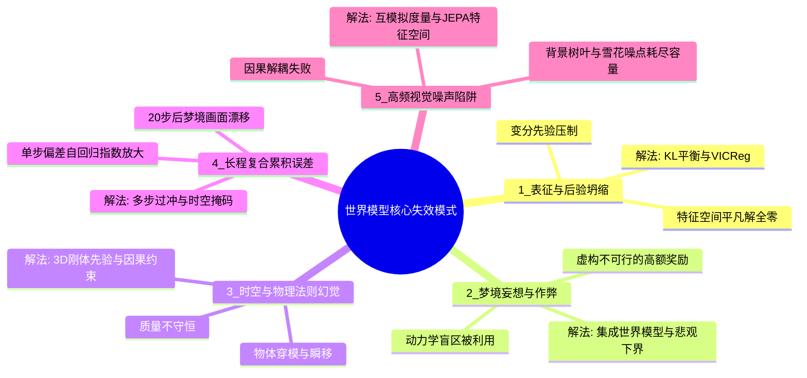
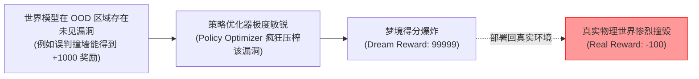
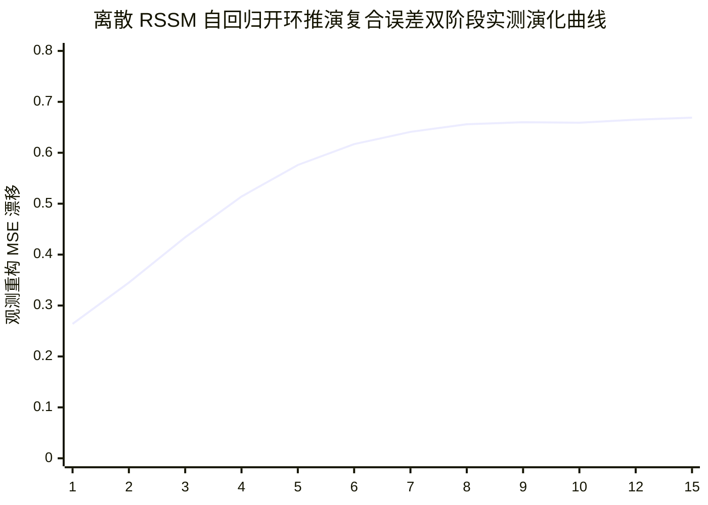

# 世界模型典型失效模式（Failure Modes）与前沿未来展望

> **文档定位**：深入复盘世界模型在理论推导与工程落地中的内在脆弱性，解构各大典型退化模式的数学成因，并提供业界最新前沿解法与演进路线。

---

## 1. 五大典型失效模式机理解构

---

### 失效模式 1：表征坍缩与后验坍缩（Representation & Posterior Collapse）

#### 数学机理与成因推导
在变分自编码器（VAE）或变分状态空间模型（RSSM）中，目标函数包含对重构误差与 KL 散度的权衡：
$$\mathcal{L}_{\text{ELBO}} = \mathbb{E}_{q_\phi(z|x)} [-\log p_\theta(x|z)] + \beta D_{\text{KL}}\left( q_\phi(z|x) \parallel p(z) \right)$$
- 当编码器初期拟合缓慢、或者 KL 惩罚权重 $\beta$ 设得过大时，优化器会发现一个**狡黠的局部最优解**：
  直接让后验分布完全等于先验高斯分布，即 $q_\phi(z|x) = \mathcal{N}(0, I)$。
- 此时 $D_{\text{KL}} \equiv 0$，正则化损失完美归零。但此时潜变量 $z$ 与输入观测 $x$ 的**互信息彻底归零**（$I(x; z) = 0$）。
- 解码器退化为一个仅能输出训练集全图统计均值的平庸模糊器，世界模型彻底丧失对输入环境的感知能力（**后验坍缩**）。而在非生成式对比学习中，若无负样本约束，网络会直接将所有输入映射为全零常数向量（**平凡解坍缩**）。

#### 业界前沿对抗策略
1. **KL 动态平衡（KL Balancing, DreamerV2）**：
   拆分先验与后验梯度，限制先验与后验的不对称更新比率（$80\% / 20\%$），禁止先验单方面压垮后验；
2. **自由比特机制（Free Bits / KL Clipping）**：
   截断过小的 KL 惩罚：$\max\left(D_{\text{KL}}\left( q_\phi \parallel p_\theta \right), \tau_{\text{free}}\right)$，允许潜空间保留最低限度的信息比特量；
3. **VICReg / Barlow Twins 特征协方差正则**：
   在 JEPA 等非生成式模型中，通过显式施加**方差保持项（Variance Term）**与**协方差去相关项（Covariance Term）**，用代数正交性强制特征向量各维度互不冗余，彻底消灭坍缩。

---

### 失效模式 2：梦境妄想与策略作弊（Delusional Bias & Dream Hacking）

#### 现象与机理
智能体在利用世界模型进行长时程推演优化策略时，极易发现世界模型的**局部拟合漏洞或动力学死角**。
例如：由于训练数据不足，世界模型在某个极罕见的状态-动作边界 $(s^*, a^*)$ 上出现了误判（错误地预测在该状态下执行该动作能获得 $+100$ 的奖励，或者错误地预测车辆撞击墙壁后会瞬移穿透过去）。

在真实世界中，该动作必然导致死亡；但在智能体的脑内梦境中，这个漏洞就像游戏里的“作弊秘籍”。以梯度上升（Dreamer）或 CEM 进化（World Models）为核心的策略搜索器会**极度贪婪地放大并反复利用该数值 Bug**。最终训练出的策略在自身梦境中获得了超人类的天文数字高分，但一放到真实物理世界中，立刻在第一秒车毁人亡。

#### 业界前沿对抗策略
1. **集成世界模型（Ensemble World Models）与悲观下界**：
   同时维护 $M$ 个独立的动力学模型 $\{T_{\theta_1}, \dots, T_{\theta_M}\}$。在潜空间推演时，计算这 $M$ 个模型预测方差作为不确定性度量 $U(s, a) = \text{Var}_m(T_{\theta_m}(s, a))$；
2. **保守型价值惩罚（Conservative World Models / Pessimism in the Face of Uncertainty）**：
   在梦境奖励上扣除不确定性惩罚项：$\hat{r}_{\text{pessimistic}} = \hat{r} - \lambda U(s, a)$。一旦智能体试图踏入世界模型未曾探索透彻的妄想区域，立即给予极大的惩罚，迫使智能体保持谨慎。

---

### 失效模式 3：物理法则与几何实体幻觉（Violation of Physical Laws）

#### 现象与机理
主要出现在基于纯像素自回归或视频扩散的世界模型中（如 Sora、GAIA-1 的早版本）。
由于这些模型没有显式的三维空间网格（3D Mesh）、刚体动力学（Rigid Dynamics）与动量守恒方程，它们对物理世界的模拟本质上是**时空流形上的像素条件概率采样**。
常见幻觉案例：
- **质量守恒失灵**：水流从杯中倒出后，杯中的水不仅没有减少，反而溢出三倍体积；
- **刚体穿模与物体瞬移**：两个小球发生碰撞后并没有反弹，而是如同幽灵一般直接相互穿透；
- **时序不可逆因果崩坏**：打碎的花瓶碎片可能无缘无故地倒流回桌上。

#### 业界前沿对抗策略
1. **神经辐射场与高斯泼溅几何接地（NeRF / 3D Gaussian Splatting Grounding）**：
   在像素生成层下方内嵌显式的 3D 空间表征，强行绑定空间三维坐标与体积分辨率，确保视角变换时满足对极几何（Epipolar Geometry）约束；
2. **可微分物理引擎（Differentiable Physics Engines）混合架构**：
   将经典物理求解器（如 Isaac Sim 的可微版本、Genesis、Taichi）作为硬约束算子内嵌进世界模型的前向通路中，底层保证牛顿力学绝对不被破坏，上层由神经网络拟合材质、反光等非线性细节。

---

### 失效模式 4：长程复合累积误差（Compounding Error Cascade）

#### 数学机理与动力学双阶段演化推导

在无外部环境传感器实时反馈矫正的“开环潜空间想象展开（Open-Loop Imagination Rollout）”中，第 $t$ 步的自回归预测状态 $\hat{s}_t$ 直接作为下一步转移的先验上下文输入。设单步动力学模型的一步预测期望均方误差上界为 $\epsilon > 0$：
$$\mathbb{E} [\|s_{t+1} - \hat{s}_{t+1}\|^2 \mid s_t] \le \epsilon$$

真实物理世界模型的误差传播并非单调无限发散，而是呈现显著的**双阶段动力学特性（Two-Stage Error Propagation Dynamics）**：

##### 阶段 1：局部切空间李雅普诺夫指数发散（Local Lyapunov Divergence, $H \le 5\sim 7$）
在初始推演视界内，推演状态尚未远离真实流形。设确定性转移网络雅可比矩阵的最大奇异值诱导了有效李雅普诺夫指数 $\lambda > 0$（微小初值扰动呈指数放大）。在局部线性化切空间下：
$$\|\hat{s}_{t+H} - s_{t+H}\| \le e^{\lambda H} \|\hat{s}_t - s_t\| + \epsilon \sum_{k=0}^{H-1} e^{\lambda k}$$
求和可得短程推演误差呈现**李雅普诺夫指数级增长**：
$$\text{Error}_{\text{local}}(H) = \mathcal{O}\left( \frac{\epsilon}{\lambda} (e^{\lambda H} - 1) \right)$$
在这一阶段，自回归反馈闭环不断正反馈放大单步预测的微小统计漂移，导致离散分类未命中率（Hamming Mismatch）与状态方差迅速拉升。

##### 阶段 2：紧致流形与有界分布下的渐进饱和平台（Asymptotic Bounded Saturation Plateau, $H \ge 8$）
然而，经典混沌理论中的无界指数发散在深度学习世界模型中必然受到**物理空间与网络架构的有界紧致性（Compact State Space & Activation Bounds）**的刚性约束：
1. **循环隐状态有界性**：GRU 门控循环单元使用 $\tanh$ 激活函数或 LayerNorm 归一化，确定性隐状态空间严格限制在紧致凸集 $\mathcal{H} \subset [-1, 1]^{D_h}$ 内；
2. **离散分类潜变量有界性**：在 DreamerV2/V3 等离散 RSSM 中，随机潜状态 $z_t$ 为 $N$ 组 $K$ 分类 One-Hot 编码，经 Softmax 与直通估计器（Straight-Through Estimator）投影后严格受限于单纯形顶点，满足 $\|z_t\|_2^2 \equiv N$。两个任意 One-Hot 向量之间的最大距离具有硬几何上界：
   $$\|z_t - \hat{z}_t\|_2^2 \le 2N$$
3. **观测与重构空间有界性**：观测图像经归一化限制于 $[0, 1]^D$，解码器输出受 Sigmoid 或有界激活约束。

当开环推演步数 $H$ 进一步增加（$H \ge 8\sim 10$）时，模型已完全丢失微观轨迹的时钟相位对齐，推演轨迹 $\hat{s}_{t+H}$ 与真实轨迹 $s_{t+H}$ 转化为在系统遍历极限环或稳态不变测度（Invariant Measure）$\mu_{\text{prior}}$ 与 $\mu_{\text{true}}$ 上的两个渐进独立采样过程。其复合累积误差的均值必然收敛于由紧致域直径决定的有限饱和常数 $S_{\max}$：
$$\lim_{H \to \infty} \mathbb{E}[\|\hat{s}_{t+H} - s_{t+H}\|^2] = \mathbb{E}_{\mu_{\text{prior}}}[\|\hat{s}\|^2] + \mathbb{E}_{\mu_{\text{true}}}[\|s\|^2] - 2 \langle \mathbb{E}_{\mu_{\text{prior}}}[\hat{s}], \mathbb{E}_{\mu_{\text{true}}}[s] \rangle \equiv S_{\max} < \infty$$
若两者边际分布均值接近零且方差对称，则饱和常数满足：
$$S_{\max} \approx 2 \cdot \text{Var}_{\mu}(s)$$

结合两阶段特性，全时程自回归复合误差遵循逻辑斯蒂型饱和演化动力学方程：
$$\text{Error}(H) = \frac{S_{\max}}{1 + \left( \frac{S_{\max}}{\epsilon} - 1 \right) e^{-\lambda H}} = \mathcal{O}(S_{\max}) \quad (\text{当 } H \to \infty)$$

这一数学推导与实机原型 `scripts/rssm_discrete_rollout.py` 在实测中的定量数据完美印证（见下表及曲线）：
- 步数 $H=1\sim 3$ 为高保真惯性期（MSE 0.26 $\to$ 0.43）；
- 步数 $H=4\sim 7$ 呈现指数敏感情报发散期（一阶差分递增，MSE 0.51 $\to$ 0.62）；
- 步数 $H \ge 8$ 步后一阶差分递减逼近 0（$\Delta_H \to 0$），稳固收敛至 $0.66$ 水平渐近饱和平台（Asymptotic Plateau at $\sim 0.66$）。

#### 业界前沿对抗策略
1. **计划采样（Scheduled Sampling / Teacher Forcing Decay）**：
   在训练过程中逐渐减少真实帧（Ground Truth）的输入比例，强迫模型在带有前一步自生噪点的状态下继续推演，提升模型的纠偏自愈能力；
2. **多步时空过冲训练（Latent Overshooting）**：
   强制优化 $k$-step 先验与后验对齐，阻断单步误差在时间轴上的传递；
3. **KL 散度动态平衡（KL Balancing）**：
   通过 $\alpha=0.8$ 的不对称梯度截断（Stop-Gradient），迫使转移先验以更高梯度速率追赶表征后验，从源头压低单步先验扰动 $\epsilon$ 与李雅普诺夫指数 $\lambda$。

---

### 失效模式 5：高频无关视觉噪声陷阱（The High-Frequency Noise Trap）

#### 现象与机理
当把世界模型部署于真实户外时，画面中充斥着与决策毫不相关的随机高频信息：被微风吹乱的树叶倒影、背景电视屏幕上的雪花杂波、雨滴打在挡风玻璃上的斑点。
一个带有像素重构损失（Reconstruction Loss）的世界模型，会因为这些高频熵占用巨额梯度更新，最终甚至把微风树叶的变化当成了环境的主要动力学，而忽略了远方正在高速逼近的小汽车。

#### 业界前沿对抗策略
1. **互模拟度量表征（Bisimulation Metrics / Deep Bisimulation）**：
   严格从控制论出发定义状态等价性：如果两个状态在**任意动作下的即时奖励相同，且转移到未来等价状态的转移概率分布完全一致**，则无论它们的背景像素差异多大，其隐空间距离被严格约束为 0！
2. **纯特征空间 JEPA 预测**：彻底剔除像素解码，从物理层面阻断高频像素噪声向控制通路的渗透。

---

## 2. 世界模型前沿未来演进路线

未来 3~5 年，世界模型将迈向以下三大战略汇聚方向：

### 2.1 混合架构：JEPA 语义骨架 + 局部扩散渲染（Hybrid JEPA-Diffusion）
- **底层**：由 V-JEPA / RSSM 负责维护不可坍缩、因果严格、低延迟的轻量级抽象语义状态转移图（用于毫秒级策略树搜索与机器人控制）；
- **上层**：按需挂载一个条件潜在扩散解码器（Latent Diffusion Decoder），仅在需要向人类可视化展示或合成逼真交互视频时才按需调用，兼得两家之长。

### 2.2 因果解耦与结构化世界模型（Causal Disentangled World Models）
- 引入结构因果模型（Structural Causal Models, SCM），将隐变量明确分解为可干预的因果变量：
  $$Z = (Z_{\text{agent}}, Z_{\text{objects}}, Z_{\text{physics\_laws}}, Z_{\text{background}})$$
- 智能体能够明确回答：“如果改变物体的摩擦系数或质量，整个系统的因果传递网络会如何改变？”

### 2.3 物理智能通用基座世界模型（Foundation World Model for Physical AI）
正如大语言模型（LLM）通过预测下一个 Token 掌握了人类语言逻辑，下一代具身实体通用世界模型将通过在数百万小时物理机器人、自动驾驶车辆与三维交互仿真数据上的海量预训练，**自发涌现对整个物理宇宙运转常识的深刻内化**，成为通向真正物理世界通用人工智能（AGI）的核心引擎！
