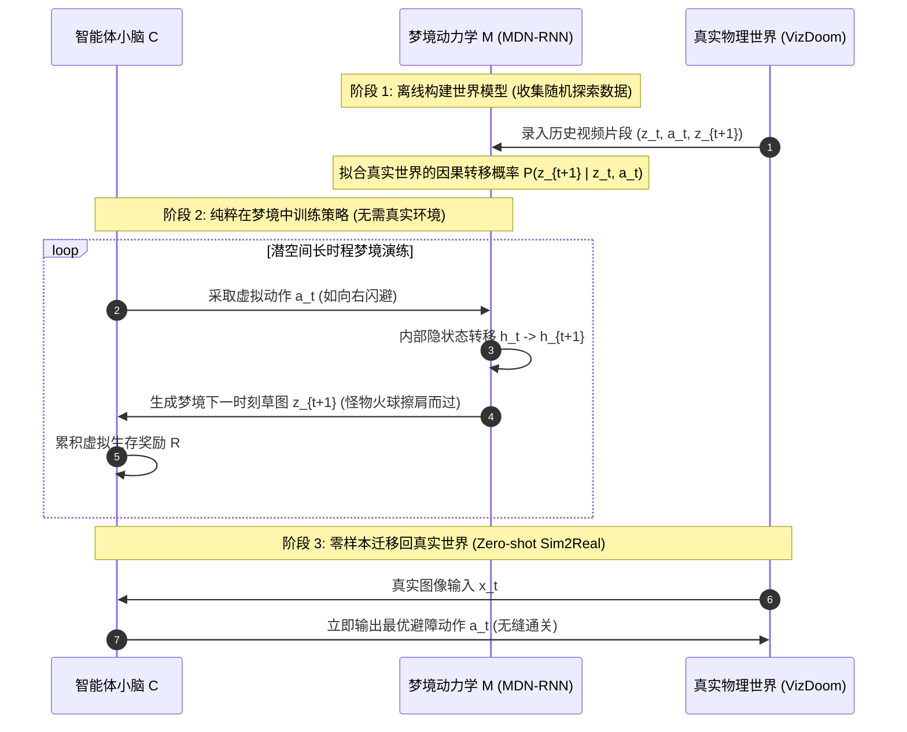

# 01. Ha & Schmidhuber 开山之作：World Models (2018)

> **论文原名**：*World Models* (NeurIPS 2018 Oral)  
> **作者**：David Ha (Google Brain), Jürgen Schmidhuber (IDSIA)  
> **核心定位**：现代深度强化学习世界模型的奠基之作，首次完整跑通“感知编码 - 记忆动力学 - 梦境中策略进化”的三位一体闭环。

---

## 1. 形象比喻：一个在睡梦中练就车技的“心智模拟器”

想象你正在玩一款极速赛车游戏，屏幕上赛道飞逝。一个普通的新手（传统 Model-Free 智能体）必须把车开上赛道成千上万次，反复撞墙跌落悬崖，才能在痛苦中缓慢摸索出弯道的抓地感觉。

而 Ha & Schmidhuber 提出的 **World Models** 就像一个具有极强想象力的人类赛车手：
1. **视觉皮层（V）**：扫一眼复杂的赛道仪表盘和障碍物，迅速在脑海中将其压缩成一张极度极简的草图（32 个潜变量特征）；
2. **海马体记忆区（M）**：在闭上双眼睡觉时，根据大脑留存的物理记忆，自己在脑海中“放映电影”——推演当你猛打方向盘时，草图上的弯道和护栏会如何滑动与逼近；
3. **小脑运动皮层（C）**：直接在自己梦境编织的虚拟赛道中疯狂练习几万次过弯。当他第二天睁开眼睛坐进真实座舱时，他的小脑神经元已经拥有了无与伦比的条件反射。

```mermaid
flowchart TD
    subgraph Wakefulness ["清醒状态 (Wake / Observation)"]
        RawImg["高维像素观测 x_t (64x64x3)"] -->|编码压缩| V_Module["V 模型: 变分自编码器 (VAE)"]
        V_Module -->|隐空间向量 z_t| M_Module["M 模型: 混合密度循环网络 (MDN-RNN)"]
        ActionReal["真实环境动作 a_t"] --> M_Module
    end

    subgraph Dreaming ["梦境状态 (Dream / Pure Latent Simulation)"]
        InitZ["初始潜状态 z_0"] --> MDN["MDN-RNN 时序推演"]
        MDN -->|混合高斯采样| NextZ["下一时刻潜状态 z_{t+1}"]
        NextZ --> Controller["C 模型: 紧凑控制器 (Linear / CMA-ES)"]
        Controller -->|虚拟动作 a_{t+1}| MDN
        NextZ -.->|可选: 梦境可视化| V_Dec["VAE 解码器 (视化梦境画面)"]
    end
```

---

## 2. 三位一体架构拆解与数学机理

World Models 架构优雅地将复杂的决策心智分解为三个高度解耦的子模块：**V (Vision)**、**M (Memory)**、**C (Controller)**。

### 2.1 V 模型：视觉压缩编码器（Convolutional VAE）
- **职责**：消除高维视觉冗余，将 $64 \times 64 \times 3$ 的 RGB 图像压缩为 32 维的高斯分布。
- **数学形式**：
  给定观测图像 $x_t$，编码器输出潜变量的均值 $\mu_t$ 与对数方差 $\log \sigma_t^2$：
  $$q_\phi(z_t | x_t) = \mathcal{N}(\mu_\phi(x_t), \text{diag}(\sigma_\phi^2(x_t)))$$
  利用重参数化技巧（Reparameterization Trick）采样隐向量：
  $$z_t = \mu_t + \sigma_t \odot \epsilon, \quad \epsilon \sim \mathcal{N}(0, I)$$
  解码器负责重建原始图像 $\hat{x}_t = p_\psi(x_t | z_t)$。
- **损失函数（ELBO）**：
  $$\mathcal{L}_{\text{VAE}}(\phi, \psi) = \mathbb{E}_{q_\phi(z_t|x_t)} [\|x_t - \hat{x}_t\|_2^2] + D_{\text{KL}}\left( q_\phi(z_t|x_t) \parallel \mathcal{N}(0, I) \right)$$
  其中 KL 散度项迫使隐空间呈现紧凑的单峰各向同性高斯先验，防止隐变量发散。

### 2.2 M 模型：混合密度循环神经网络（MDN-RNN）
- **职责**：世界模型的心脏。负责时序动力学预测。因为现实物理世界往往具备**多模态不确定性**（例如赛车撞击护栏后可能弹向左侧，也可能打转滑向右侧），传统的单均值预测回归（如 MSE）会导致输出模棱两可的模糊平均值。
- **数学形式**：
  采用由 LSTM 与混合高斯模型（Mixture Density Network, MDN）组合而成的结构。在每个时刻 $t$，根据当前的隐状态 $z_t$、历史隐变量记忆 $h_{t-1}$ 以及执行的动作 $a_t$：
  $$h_t = \text{LSTM}(h_{t-1}, [z_t, a_t])$$
  网络输出 $K$ 个高斯分量的混合参数（权重系数 $\pi_k$、均值向量 $\mu_k$、方差 $\sigma_k$）：
  $$P(z_{t+1} | a_t, z_t, h_t) = \sum_{k=1}^K \pi_k(h_t) \mathcal{N}\left(z_{t+1}; \mu_k(h_t), \text{diag}(\sigma_k^2(h_t))\right)$$
  其中混合权重通过 Softmax 保证归一化：$\sum_{k=1}^K \pi_k = 1$。
- **温度系数调节（Temperature $\tau$）**：
  在纯梦境中采样未来时，引入温度超参数 $\tau$：
  $$\hat{\sigma}_k = \sigma_k \cdot \tau^{1/2}, \quad \hat{\pi}_k = \frac{\exp(\log \pi_k / \tau)}{\sum_j \exp(\log \pi_j / \tau)}$$
  当 $\tau \to 0$ 时，梦境完全确定性，物理规律极度保守；当 $\tau > 1$ 时，梦境极具随机性和创造性，但容易产生离奇混乱。

### 2.3 C 模型：紧凑线性控制器（Controller）
- **职责**：极简的决策层，仅负责输出动作。
- **数学形式**：
  为了证明 V 与 M 已经完全提取了世界运转的所有本质特征，Ha & Schmidhuber 刻意将控制器设计为一个**极为简单的单层仿射映射**：
  $$a_t = \tanh(W_c [z_t, h_t] + b_c)$$
  该控制器参数总量仅为约 1000 个参数！
- **优化方法（CMA-ES 进化策略）**：
  控制器无需反向传播梯度，直接使用协方差矩阵自适应进化策略（CMA-ES, Covariance Matrix Adaptation Evolution Strategy）在梦境中进行群体参数搜索。

---

## 3. 核心实验震撼发现：完全在“幻觉梦境”中学会玩 Doom

作者在 VizDoom（毁灭战士）生存关卡中进行了震撼的对比实验：
智能体面对怪物发射的火球，完全不与真实 VizDoom 环境引擎交互，直接将 M 模型的推演当成真实世界：
1. 初始给定真实观测作为“引子”；
2. 随后切断真实环境，所有后续帧 $z_{t+1}$ 均来自 MDN-RNN 的自回归采样；
3. Controller 在这一纯粹由代码和张量编织的“虚拟虚空梦境”中学会了灵活走位躲避火球；
4. **将该策略无缝部署回真实 VizDoom 游戏中，智能体竟能直接获得顶级生存分数！**



---

## 4. 局限性与致命缺陷：为什么需要下一代架构？

尽管 World Models 构想惊艳，但它在工程与理论上存在三大核心缺陷，直接催生了后来的 PlaNet 与 Dreamer：

1. **模块两阶段串行训练（No End-to-End Synergy）**：
   - V 模型的训练完全无监督，只管像素压缩；M 模型的训练只管下一个隐向量预测。如果背景中有一只与任务无关但色彩斑斓的花蝴蝶，V 模型会耗费大量潜变量容量去记住这只蝴蝶，而忽略了关乎生死但尺寸极小的细小陷阱。
2. **复合累积误差（Compounding Error Explosion）**：
   - 自回归展开 20-30 步后，MDN-RNN 预测的隐变量分布开始漂移，导致梦境画面彻底崩坏为无意义的抽象噪点。
3. **“做梦作弊”与妄想偏差（Delusional Bias / Dream Hacking）**：
   - 智能体在梦境中发现了 MDN-RNN 的数值 Bug 或转移盲区（例如：当赛车朝某个奇异角度撞击时，MDN 错误地预测赛车没有撞毁反而瞬移到了终点）。CMA-ES 会极度聪明地反复利用这个模型漏洞疯狂刷分，但在真实世界中执行该动作会瞬间导致车毁人亡。
