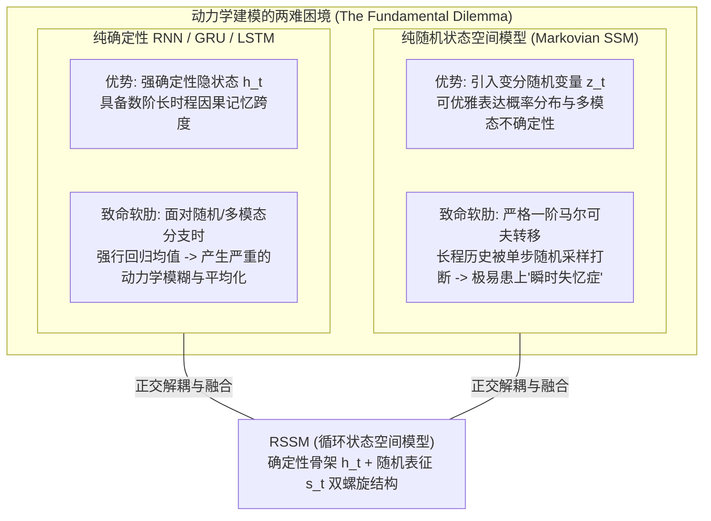
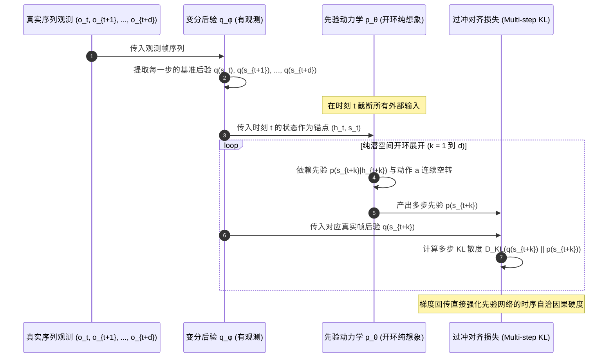
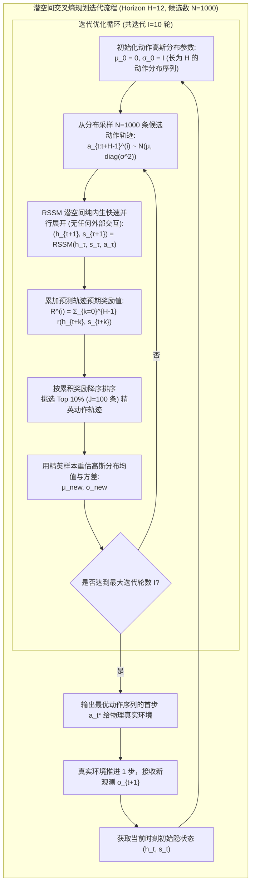

# 02. PlaNet 与循环状态空间模型（RSSM）：潜空间动力学的奠基之作

> **论文原名**：*Learning Latent Dynamics for Planning from Pixels* (ICML 2019)  
> **作者团队**：Danijar Hafner, Timothy Lillicrap, Ian Fischer, Ruben Villegas, David Ha, Honglak Lee, James Davidson (Google Brain / DeepMind)  
> **论文链接**：https://arxiv.org/abs/1811.04551  
> **代码开源**：https://github.com/google-research/planet  
> **核心地位**：现代世界模型（World Models）体系的技术分水岭。首次提出 **RSSM（Recurrent State-Space Model，循环状态空间模型）**，奠定了后续 Dreamer V1/V2/V3 全系列的状态空间核心骨架；首次在纯潜空间（Latent Space）中通过交叉熵方法（CEM）实现高维像素级在线模型预测控制（MPC），在 DeepMind Control Suite 上以比传统无模型（Model-Free）方法少 50 倍的数据量达成顶尖性能。

---

## 1. 具象化直觉比喻：脑内盲棋大师与潜意识寻路者

想象你置身于一座结构极其庞大、光线变幻莫测的迷宫：

- **传统无模型强化学习（Model-Free RL）的笨拙探索**：如同一个蒙着眼睛的探险者。他必须用真实的血肉之躯在迷宫里乱撞上百万次，每次撞到石墙跌断骨头、或者偶然摸到宝箱，才在肌肉神经元中留下微弱的本能反应。只要迷宫稍有光影变化，他就会再度迷失。
- **Ha & Schmidhuber (2018) 的初级心智模拟**：探险者虽然学会了闭眼做梦，但他脑中的“梦境放映机”（纯确定性或纯随机模型）极不稳定。在脑中推演两三步后，墙壁与道路就开始融化变形，导致他在梦境中发现了“穿墙瞬移”的 Bug，醒来一试却再度撞墙。
- **PlaNet 的高级心智构型（脑内盲棋大师）**：
  1. **潜空间极简提炼**：他扫一眼眼前纷繁复杂的火把光影与青苔砖石，只在脑中保留几十个最核心的几何因果状态（潜变量），剔除一切视觉浮光掠影；
  2. **双轨心智机制（RSSM）**：他的大脑同时运转两条精密齿轮——一条是**强韧的确定性骨架记忆**（牢牢锁定过去几十步的转弯与走廊拓扑），另一条是**灵活的随机变分推演**（敏锐捕获转角处可能遇到未知怪兽或暗门的多模态概率）；
  3. **潜意识超前推演（CEM 纯梦境规划）**：在真实身体迈出一步之前，他的潜意识在 10 毫秒内瞬间在脑海中向未来并发推演了 1000 种行动分支，每条分支展望 12 步，挑出最佳走法后，才沉着地迈出真实的第一步。

---

## 2. 核心矛盾：长程记忆（Memory）与多模态不确定性（Uncertainty）的二难困境

在 PlaNet 提出之前，针对环境动力学建模的学术探索深陷于以下两派路线的结构性缺陷：



1. **纯确定性递归网络（Deterministic RNNs）**：
   - 转移方程为 $h_t = f(h_{t-1}, a_{t-1})$。
   - *缺陷*：现实世界中物体的弹跳、遮挡、突发碰撞具备天然的随机性与多模态分布。当模型尝试用确定性网络拟合多种可能的结果时，最小化均方误差（MSE）的数学本质迫使网络输出所有可能结果的**加权平均值**。在视觉重建与动力学推演中，这表现为毁灭性的“鬼影（Ghosting）”与“轮廓融化”。
2. **纯随机马尔可夫状态空间模型（Stochastic State-Space Models）**：
   - 转移方程为 $s_t \sim p(s_t | s_{t-1}, a_{t-1})$。
   - *缺陷*：由于每一步转移都需要经历一次随机采样（Sampling Operation），随机噪声的连续注入会导致梯度传递与历史信息的指数级衰减。模型根本无法维持长达数十步的前后一致性因果记忆（例如：一个小球滚到箱子后方遮挡 5 秒后再滚出来，纯随机模型在第 2 秒就会彻底忘记箱子后有球）。

**PlaNet 的破局关键**：将动力学隐状态严格解耦为**确定性递归通路（Deterministic Path）**与**随机变分通路（Stochastic Path）**，让长程记忆由确定性 GRU 牢固承载，让多模态不确定性由变分高斯分布捕获。

---

## 3. RSSM 架构解构与时序推演机制

### 3.1 复合隐状态形式化定义
在 RSSM 中，时刻 $t$ 的完整世界状态不是单一向量，而是正交复合体：
$$\mathcal{S}_t \triangleq (h_t, s_t)$$
- **确定性隐藏状态** $h_t \in \mathbb{R}^H$：由连续循环网络（GRU 单元）维护的高维记忆向量（通常 $H = 200 \sim 1024$ 维）；
- **随机隐状态变量** $s_t \in \mathbb{R}^S$：由对角高斯分布采样的低维随机变量（通常 $S = 30$ 维），作为环境不可观测变量的信息瓶颈（Information Bottleneck）。

```mermaid
flowchart TD
    subgraph RSSM_Architecture ["RSSM 单时间步计算图 (Filtering vs Prediction)"]
        direction TB

        subgraph Inputs ["时序输入"]
            H_prev["上一时刻确定性状态 h_{t-1}"]
            S_prev["上一时刻随机状态 s_{t-1}"]
            A_prev["上一时刻动作 a_{t-1}"]
            Obs_t["当前时刻真实观测 o_t"]
        end

        subgraph DetUpdate ["确定性演化通路 (Deterministic Update)"]
            H_prev & S_prev & A_prev --> GRU_Cell["递归单元 GRU f_θ"]
            GRU_Cell --> H_curr["当前确定性状态 h_t"]
        end

        subgraph StochPath ["随机变分推断通路 (Stochastic Path)"]
            H_curr --> PriorNet["时序转移先验 p_θ(s_t | h_t)"]
            PriorNet --> DistPrior["先验分布 N(μ_p, σ_p)"]
            DistPrior --> S_prior["先验采样 s_t^prior (用于想象推演)"]

            Obs_t --> ConvEnc["卷积编码器 CNN(o_t)"]
            ConvEnc & H_curr --> PostNet["变分后验推理 q_φ(s_t | h_t, o_t)"]
            PostNet --> DistPost["后验分布 N(μ_q, σ_q)"]
            DistPost --> S_post["后验采样 s_t^post (用于训练对准)"]

            DistPost -.->|KL 散度约束 D_KL(q || p)| DistPrior
        end

        subgraph Decoders ["解码与预测头 (Emissions)"]
            H_curr & S_post --> ObsDec["图像重构解码器 p(o_t | h_t, s_t)"]
            H_curr & S_post --> RewDec["即时奖励预测器 p(r_t | h_t, s_t)"]
        end
    end
```

### 3.2 转移方程与各组件数学规范

1. **确定性状态演化（Deterministic Recurrent Model）**：
   $$h_t = f_\theta(h_{t-1}, s_{t-1}, a_{t-1})$$
   其中 $f_\theta$ 为全连接门控循环单元（GRU）。关键细节：输入中包含**上一时刻抽样得到的随机隐状态 $s_{t-1}$**，这建立了从随机概率层到确定性记忆层的反向反馈回路。
2. **时序转移先验模型（Transition Prior Model）**：
   在不接触当前真实观测（如纯脑内想象、向前多步预测）时，智能体仅依靠历史记忆 $h_t$ 预言当前随机隐变量分布：
   $$p_\theta(s_t | h_t) = \mathcal{N}\left(s_t; \, \mu_\theta(h_t), \, \text{diag}(\sigma_\theta^2(h_t))\right)$$
   先验网络由双层 MLP 实现，输出均值 $\mu_\theta$ 与方差 $\sigma_\theta = \text{softplus}(\cdot) + \epsilon_{\min}$。
3. **变分后验表征模型（Representation / Posterior Model）**：
   在感知当前真实环境观测 $o_t$ 时，后验网络将真实图像特征 $e_t = \text{Enc}(o_t)$ 与确定性记忆 $h_t$ 结合，修正认知：
   $$q_\phi(s_t | h_t, o_t) = \mathcal{N}\left(s_t; \, \mu_\phi(h_t, e_t), \, \text{diag}(\sigma_\phi^2(h_t, e_t))\right)$$
4. **观测与奖励发射模型（Observation & Reward Likelihoods）**：
   给定复合状态 $(h_t, s_t)$，模型对环境的物理属性进行联合解码：
   $$p_\theta(o_t | h_t, s_t) = \mathcal{N}(o_t; \, \text{Dec}_\theta(h_t, s_t), \, I) \quad \text{或} \quad \text{Laplace}(\text{Dec}_\theta(h_t, s_t), 1)$$
   $$p_\theta(r_t | h_t, s_t) = \mathcal{N}(r_t; \, \text{MLP}_\theta(h_t, s_t), \, \sigma_r^2)$$

### 3.3 信息瓶颈（Information Bottleneck）设计的深刻哲理
为什么不把所有信息一股脑塞进确定性向量 $h_t$？
- 如果只用 $h_t$ 并直接预测未来，网络容量会无情地被环境背景中的确定性高频噪声（如草地纹理、阴影抖动）占据。
- 引入低维随机变量 $s_t$ 并施加 KL 正则项，构成了经典的**变分信息瓶颈（Variational Information Bottleneck）**：
  $$\min_{\phi} I(O_{1:t}; S_t) \quad \text{s.t.} \quad \max_{\theta} I(S_t; O_{t+1}, R_t)$$
  KL 散度强制约束后验分布向简单高斯收拢，迫使编码器主动抛弃不可预测的微观瞬态噪声，仅提炼能够支撑未来动力学推演的核心因果宏观表征。

---

## 4. 多步潜空间过冲（Latent Overshooting）：根除复合误差

### 4.1 单步预测模型的“因果漂移”陷阱
传统自回归序列模型通常采用单步极大似然估计：在每一步训练中，后验网络都会读取真实的 $o_t$ 来“校准”状态。
这导致了一个致命的**分布偏移（Distribution Shift / Compounding Error）**问题：
- 在训练阶段，模型每走一步都被保姆式地拉回真实轨迹；
- 在实际规划阶段，智能体必须在潜空间中连续展望 10~15 步，此时没有任何真实观测来校正。
单步预测的微小方差会在自回归推演中以几何级数扩散，造成动力学预测在 5 步后彻底崩塌。

### 4.2 潜空间过冲训练机制
为了解决目标不匹配问题，PlaNet 提出了**多步潜空间过冲（Latent Overshooting）**：在训练阶段强制截断观测，强迫模型在脑内进行多步“开环盲推”，并要求盲推得到的先验分布与未来多步后的真实变分后验保持对齐。



其多步目标数学形式为：
$$\mathcal{L}_{\text{overshoot}}^d = \frac{1}{d} \sum_{k=1}^d \mathbb{E}_{q}\left[ D_{\text{KL}}\left( q(s_{t+k} | h_{t+k}, o_{t+k}) \parallel p(s_{t+k} | h_{t+k}) \right) \right]$$
通过在潜空间施加跨步长因果约束，PlaNet 赋予了世界模型在毫无感知矫正时依然能够保持平稳、准确向前推演 12 步物理过程的强大内驱力。

---

## 5. 变分自由能（ELBO）完整数学推导

PlaNet 采用变分自编码推断框架。设时间序列长度为 $T$，环境观测为 $o_{1:T}$，动作为 $a_{1:T-1}$，奖励为 $r_{1:T}$。

### 5.1 联合生成概率分布
$$p_\theta(o_{1:T}, r_{1:T}, s_{1:T} | a_{1:T-1}) = \prod_{t=1}^T p_\theta(s_t | h_t) p_\theta(o_t | h_t, s_t) p_\theta(r_t | h_t, s_t)$$
其中 $h_t = f_\theta(h_{t-1}, s_{t-1}, a_{t-1})$ 为确定性演化。

### 5.2 变分推断后验分布
$$q_\phi(s_{1:T} | o_{1:T}, a_{1:T-1}) = \prod_{t=1}^T q_\phi(s_t | h_t, o_t)$$

### 5.3 证据下界（ELBO）推导
根据 Jensen 不等式，真实数据对数似然满足：
$$\ln p_\theta(o_{1:T}, r_{1:T} | a_{1:T-1}) = \ln \int q_\phi(s_{1:T}) \frac{p_\theta(o_{1:T}, r_{1:T}, s_{1:T} | a_{1:T-1})}{q_\phi(s_{1:T} | o_{1:T}, a_{1:T-1})} d s_{1:T}$$
$$\ge \mathbb{E}_{q_\phi} \left[ \ln \frac{p_\theta(o_{1:T}, r_{1:T}, s_{1:T} | a_{1:T-1})}{q_\phi(s_{1:T} | o_{1:T}, a_{1:T-1})} \right] \triangleq \mathcal{L}_{\text{ELBO}}(\theta, \phi)$$

展开分子分母乘积形式，并合并同类项：
$$\mathcal{L}_{\text{ELBO}}(\theta, \phi) = \sum_{t=1}^T \Big( \underbrace{\mathbb{E}_{q_\phi}[\ln p_\theta(o_t | h_t, s_t)]}_{\text{图像重构似然}} + \underbrace{\mathbb{E}_{q_\phi}[\ln p_\theta(r_t | h_t, s_t)]}_{\text{即时奖励预测似然}} - \underbrace{D_{\text{KL}}\left( q_\phi(s_t | h_t, o_t) \parallel p_\theta(s_t | h_t) \right)}_{\text{单步信息瓶颈先验对齐}} \Big)$$

结合权重超参数 $\beta$ 与多步过冲扩展，总训练目标为最小化变分自由能损失：
$$\mathcal{L}_{\text{PlaNet}}(\theta, \phi) = \sum_{t=1}^T \left( \mathcal{L}_{\text{rec}}(o_t, \hat{o}_t) + c_r \mathcal{L}_{\text{reward}}(r_t, \hat{r}_t) + \beta D_{\text{KL}}\big(q_\phi(s_t) \parallel p_\theta(s_t)\big) \right) + \sum_{d>1} \lambda_d \mathcal{L}_{\text{overshoot}}^d$$

---

## 6. 纯潜空间交叉熵方法（CEM）在线规划

与绝大多数强化学习算法（包含 DQN、PPO、SAC）不同，PlaNet **完全没有显式策略网络（No Actor Network）**。它的所有控制行为完全来自于测试时（Test-time）在潜空间执行的**模型预测控制（MPC）**。

### 6.1 CEM 规划算法的潜空间流转全流程



### 6.2 算法核心参数与工程实现细节
1. **规划视野（Planning Horizon）**：设为 $H = 12$。在这一时域内，RSSM 的开环推演精度极高。
2. **候选轨迹数量（Population Size）**：每一轮采样 $N = 1000$ 条轨迹。在现代 GPU 上，将这 1000 条动作序列拼接为一个 Batch 并行送入 RSSM 前向推理，耗时仅数毫秒。
3. **精英保留与动量更新（Momentum Fitting）**：
   在迭代更新高斯参数时，引入动量系数 $\alpha = 0.1$，防止单轮精英样本局部过拟合：
   $$\mu^{(k)} = \alpha \mu_{\text{elite}} + (1 - \alpha) \mu^{(k-1)}$$
   $$\sigma^{(k)} = \alpha \sigma_{\text{elite}} + (1 - \alpha) \sigma^{(k-1)}$$
4. **模型预测控制闭环（Receding Horizon Control）**：
   尽管在脑内规划出了未来 12 步的最优动作序列 $(a_t^*, a_{t+1}^*, \dots, a_{t+11}^*)$，**智能体仅在真实环境中执行第一步 $a_t^*$**。在收到下一步的真实图像 $o_{t+1}$ 后，后验网络立即修正隐状态，并将滑动窗口前移一位，重新展开新一轮 CEM 搜索。这种“走一步，脑内狂想万步，再走一步”的机制对物理扰动具备极强的容错弹性。

---

## 7. 实验突破与重大基准评测

PlaNet 在连续动作控制领域的权威基准 **DeepMind Control Suite (DMC)** 上进行了严密的实证检验，覆盖以下高难度连续视觉控制任务：
- `Cartpole Swingup`（小车倒立摆大摆幅起摆）
- `Reacher`（双自由度机械臂触碰目标）
- `Cheetah Run`（六足猎豹高速奔跑）
- `Finger Spin`（机械指高速旋转物块）
- `Cup Catch`（球杯甩球精准接纳）
- `Walker Walk`（双足双腿协调行走）

### 7.1 核心对比评测数据

| 算法模型 | 算法流派 | 输入类型 | DMC 达标平均步数 (Environment Steps) | 相当于游戏真实时长 | 相比 Model-Free 样本效率提升倍数 |
| :--- | :--- | :--- | :--- | :--- | :--- |
| **A3C** | Model-Free Policy Gradient | 纯视觉 RGB | $\sim 50,000,000$ 步 | $\approx 230$ 小时 | 基准 (1x) |
| **D4PG** | Model-Free Off-policy Actor-Critic | 纯视觉 RGB | $\sim 10,000,000$ 步 | $\approx 46$ 小时 | 5x |
| **PlaNet (ICML 2019)** | **基于视觉的世界模型 (RSSM + CEM)** | **纯视觉 RGB** | **$\sim 100,000 \sim 200,000$ 步** | **$\approx 1 \sim 2$ 小时** | **50x ~ 100x** |

### 7.2 关键消融实验发现（Ablation Insights）
1. **纯确定性 vs. 纯随机 vs. RSSM 双通路消融**：
   - 移除随机通路（纯 GRU）：模型在训练集重构良好，但在测试集预测出现崩溃，规划成功率骤降 60%；
   - 移除确定性通路（纯马尔可夫 SSM）：在 `Cheetah Run` 这类需要长时间维持惯性与步态周期的任务上，平均分数仅为 RSSM 的 20%；
   - **双通路 RSSM** 在所有 6 项测试中均以巨大优势领先，证实了记忆与随机分离架构的不可替代性。
2. **Latent Overshooting 的效果**：
   引入多步过冲后，潜空间 12 步开环预测的均方误差（MSE）下降了近 3 倍，使得 CEM 在深层规划步数下的轨迹评估极其可靠。

---

## 8. PlaNet 的历史局限性：为什么它必须被重构？

尽管 PlaNet 取得了颠覆性的成功，但 Danijar Hafner 本人在其论文中坦诚地揭示了该架构存在的两座无法翻越的高山：

### 8.1 规划视野受限（Planning Horizon Bottleneck）
CEM 本质上是一种在连续动作空间中的**局部零阶随机优化算法（Zero-order Random Search）**：
- 当规划步长 $H \le 12$ 时，动作空间维度为 $H \times D_a$（约数十维），高斯分布尚能捕获有效模式；
- 当面对需要展望几百步的长期任务（例如通关游戏、复杂迷宫寻路）时，高维空间中的有效高回报动作序列稀疏得如同沙滩上的一粒金子。随机采样 $N=1000$ 个样本甚至连一个碰巧解题的序列都抽不到，采样效率断崖式下跌；
- 另外，CEM 仅优化当前窗口内的有限即时奖励总和 $\sum_{k=0}^{H-1} r_{t+k}$，**完全没有考虑第 $H$ 步之后的长远价值（No Long-term Value Function $V(s)$）**，是一个典型的“近视眼（Myopic）”规划器。

### 8.2 推理延迟过高（Inference Latency & Computational Overhead）
在机器人实际部署或高帧率实时游戏中：
- 智能体在每个物理时间步都必须在 GPU 上并行展开 $1000 \times 10 = 10,000$ 次 RSSM 前向传播；
- 单帧决策耗时高达数十甚至上百毫秒，根本无法接入要求 100Hz 以上响应的敏捷四足机器人或四旋翼飞行器控制系统。

**这一深刻痛点，驱动了团队在次年做出一项重大抉择：必须在世界模型中引入一个常驻的 Actor-Critic 策略网络，让策略直接在潜意识梦境中通过解析梯度进化——这便点燃了 Dreamer 时代的黎明！**
