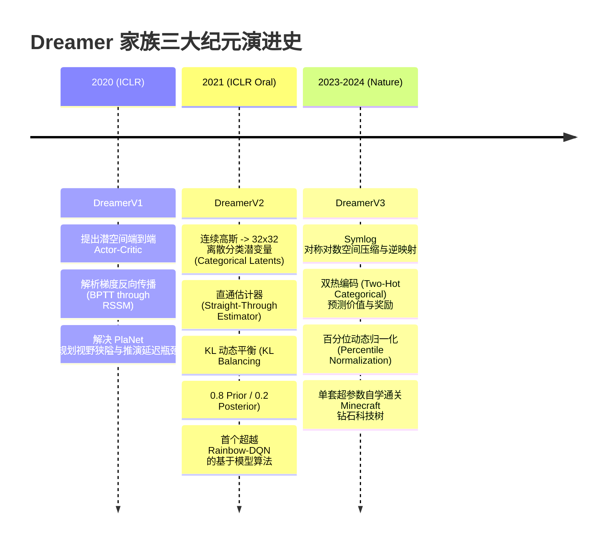
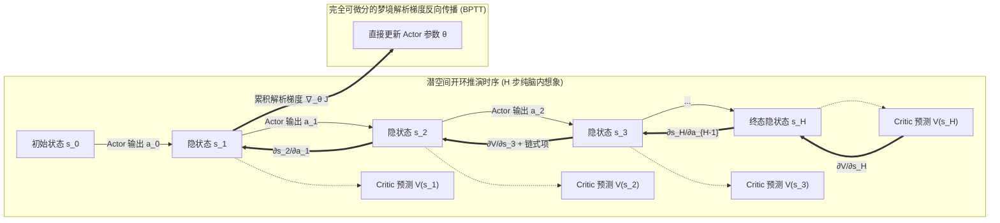
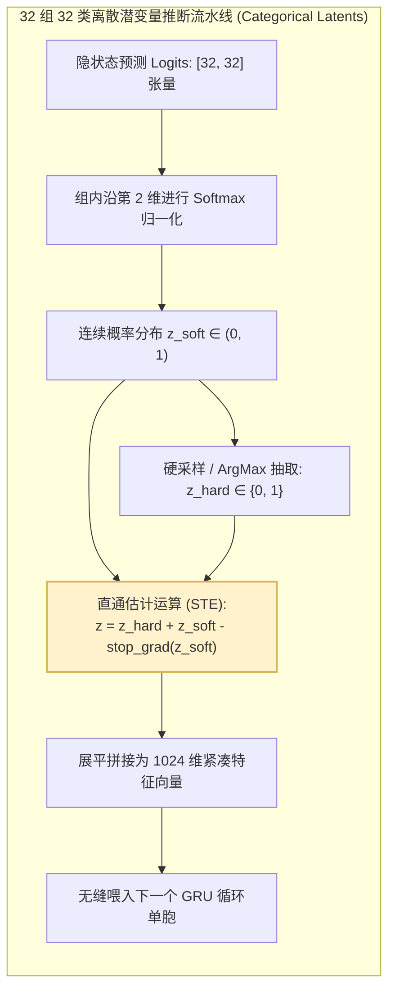
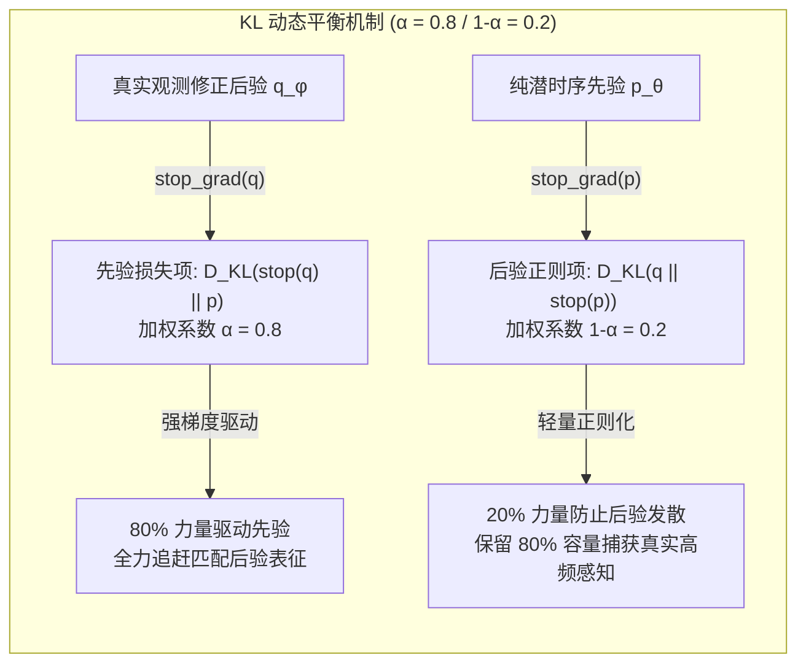
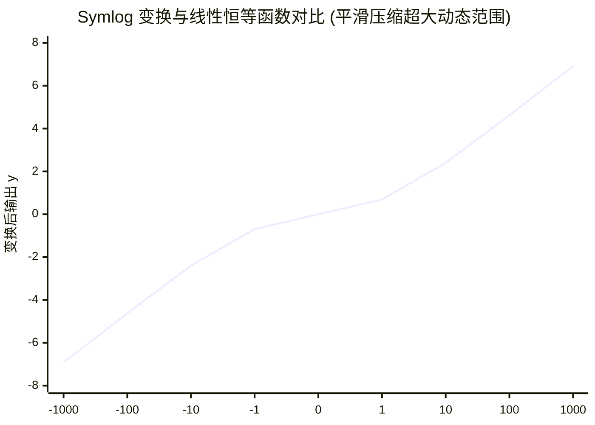
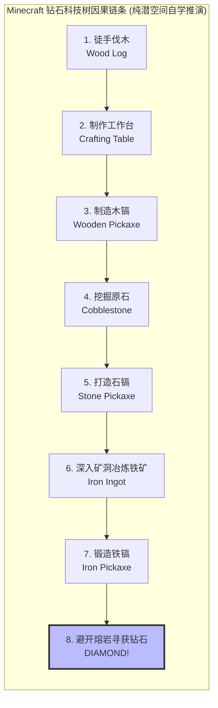

# 03. 登峰造极：Dreamer 进化三部曲（V1 → V2 → V3）与世界模型通用化史诗

> **核心文献**：
> 1. **DreamerV1**: *Dream to Control: Learning Behaviors by Latent Imagination* (ICLR 2020) — Danijar Hafner, Timothy Lillicrap, Jimmy Ba, Mohammad Norouzi  
> 2. **DreamerV2**: *Mastering Atari with Discrete World Models* (ICLR 2021 Oral) — Danijar Hafner, Timothy Lillicrap, Mohammad Norouzi, Jimmy Ba  
> 3. **DreamerV3**: *Mastering Diverse Domains through World Models* (Nature 2024 / arXiv 2023) — Danijar Hafner, Jurgis Pasukonis, Jimmy Ba, Timothy Lillicrap  
> **代码仓库**：https://github.com/danijar/dreamerv3  
> **核心历史地位**：深度强化学习与世界模型领域无可争议的**黄金行业标准**。完成了从“连续机械臂的局部梦境推演（V1）”，到“击破 Atari 离散多变逻辑超越无模型顶尖算法（V2）”，最终实现“以完全相同的一组超参数横跨 150+ 领域，并在无人类先验数据下自主通关《我的世界》（Minecraft）采集钻石（V3）”的史诗级技术跨越。

---

## 1. 具象化直觉进化历程：从幼童试探到全能通用心智

Dreamer 家族的每一次迭代，都是对智能体大脑工作范式的一次深刻革命：

- **DreamerV1（掌握肌肉直觉的灵童）**：
  他意识到 PlaNet 每次迈步前在脑中抓阄采样（CEM）太慢、太笨拙。于是他赋予自己一个**常驻小脑（Actor）**与**预感直觉（Critic）**。在纯粹由数学偏导数构成的光滑梦境中，动作对未来收益的推动力可以直接顺着时间反向流动（BPTT）。他闭眼练功数万次，学会了平滑控制机械臂翻腾奔跑。
- **DreamerV2（看破离散本质的街机战神）**：
  当他面对《吃豆人》或《太空侵略者》时，连续高斯分布的大脑被击溃了——因为“命丧黄泉”或“吃掉金币”是瞬间突变的布尔状态，高斯平滑让世界变得混沌模糊。于是他做了一次**神经突触离散化改造**：将大脑潜空间换成 $32 \times 32$ 个可切换状态的“二进制离散开关”，并发明了 **KL 动态平衡**，强行命令记忆区（先验）承担 80% 的追赶压力，成功征服 Atari 55 款复杂游戏。
- **DreamerV3（适应一切极端宇宙的终极旅行者）**：
  当他被投放到 Minecraft 荒野时，面对从 +0.001（采集木屑）到 +1000（挖得钻石）的悬殊奖励，以及从沙漠到暗黑矿井的视觉风暴，普通神经网络早已梯度爆炸。他装载了 **Symlog 空间折叠雷达**、**动态百分位归一化天平** 与 **双热离散分类预警器**。他不改动哪怕一个参数，在无人教导的情况下，从徒手撸树开始，一步步打磨石镐、铁镐、深入熔岩地洞，最终高举钻石！

---

## 2. Dreamer 进化全景技术对比矩阵

| 技术维度 | DreamerV1 (2020) | DreamerV2 (2021) | DreamerV3 (2023/2024) |
| :--- | :--- | :--- | :--- |
| **随机潜变量形态** | 各向同性连续高斯分布 $\mathcal{N}(\mu, \sigma^2)$ | 32 个独立的 32 分类离散分布 $\prod_{i=1}^{32} \text{Cat}(\phi_i)$ | 32 个 32 分类离散变量 + Uniform Prior 约束 |
| **梯度传导机制** | 高斯重参数化技巧（Reparameterization Trick） | 直通估计器（Straight-Through Estimator） | 直通估计器 + Free Bits 软截断 |
| **行为学习范式** | 解析梯度 BPTT（Analytic Policy Gradient） | 强化学习 REINFORCE + 解析梯度混合 | REINFORCE + 动态缩放优势函数 |
| **KL 正则化方式** | 统一变分 KL 散度（$\beta \cdot D_{\text{KL}}$） | **KL 动态平衡（0.8 先验 / 0.2 后验）** | **KL 动态平衡 + 自由比特（Free Bits = 1.0）** |
| **奖励与价值预测** | 连续高斯回归（MSE 损失函数） | 标量回归 / 确定性均值回归 | **Symlog 变换 + 255-Bin 双热离散分布分类** |
| **超参数跨域鲁棒性** | 弱（不同控制环境需定制调参） | 中（连续控制与 Atari 离散游戏使用两套超参） | **极强（150+ 个基准环境严格共用单套超参数）** |
| **标志性基准突破** | DeepMind Control Suite 连续控制 SOTA | Atari 55 款游戏突破人类平均及 Rainbow | **Minecraft 0 样本纯自监督自主挖得钻石** |

---

## 3. DreamerV1：端到端潜空间 Actor-Critic 与解析梯度流

### 3.1 抛弃低效 CEM：为何转向潜空间参数化策略？
PlaNet 的致命缺陷在于其“无显式策略”架构：每个时间步都要靠 CEM 在线生成上万次模拟，导致决策延迟高达数百毫秒，且搜索步长被禁锢在 $H \le 12$ 步。

DreamerV1 做出了划时代的架构转变：**在潜空间中训练一组专门的参数化策略网络（Actor $\pi_\theta(a|s)$）与价值评估网络（Critic $v_\psi(s)$）**。
- 一旦 RSSM 世界模型拟合完毕，智能体可以直接在脑海中从当前真实隐状态 $s_t$ 出发，用 Actor 和世界模型动力学连续“无感知展开”长达 $H = 15 \sim 50$ 步的虚拟轨迹；
- 展开完毕后，直接调用 Critic 预估终点状态的长远价值，彻底打破了局部规划的短视限制。

### 3.2 解析梯度回传（Analytic Policy Gradients via BPTT）
由于 RSSM 的确定性状态更新 $h_\tau = \text{GRU}(h_{\tau-1}, s_{\tau-1}, a_{\tau-1})$ 与神经网络预测完全是**连续可导的数学算子**，未来累积收益对策略网络参数 $\theta$ 的导数，不需要像传统强化学习那样依赖高方差的似然比采样（Policy Gradient Theorem），而是可以通过**时间反向传播（BPTT）**精确地沿着因果链条向前求导：

$$\nabla_\theta \mathbb{E}_{\pi}\left[ \sum_{\tau=t}^{t+H} \gamma^{\tau-t} V_\psi(s_\tau) \right] = \sum_{\tau=t}^{t+H} \mathbb{E}\left[ \underbrace{\nabla_{s_\tau} V_\psi(s_\tau)}_{\text{Critic 价值倾角}} \cdot \underbrace{\frac{\partial s_\tau}{\partial a_\tau}}_{\text{世界模型动力学响应}} \cdot \underbrace{\nabla_\theta \pi_\theta(a_\tau | s_\tau)}_{\text{策略动作调节梯度}} \right]$$

这种直接利用世界模型 Jacobian 矩阵 $\frac{\partial s_\tau}{\partial a_\tau}$ 引导策略优化的方式，使得策略更新的方向极其精准，方差大幅低于 Model-Free 算法。

### 3.3 价值目标：$\lambda$-Return 估值机制
为了在“低偏差的蒙特卡洛多步回报”与“低方差的单步 TD 估值”之间取得最优平衡，DreamerV1 在潜空间采用了广义优势估计与 $\lambda$-回报目标（$\lambda = 0.95$）：

$$V_\lambda(s_\tau) \triangleq (1 - \lambda) \sum_{n=1}^{H - 1 - \tau} \lambda^{n-1} V_n(s_\tau) + \lambda^{H - 1 - \tau} V_H(s_\tau)$$
其中 $n$ 步截断回报为：
$$V_n(s_\tau) \triangleq \sum_{k=0}^{n-1} \gamma^k \hat{r}_{\tau+k} + \gamma^n v_\psi(s_{\tau+n})$$

Critic 网络 $v_\psi$ 的训练目标即为最小化均方差损失：
$$\mathcal{L}_{\text{critic}}(\psi) = \frac{1}{2} \sum_{\tau=t}^{t+H} \left\| v_\psi(s_\tau) - \text{stop\_grad}(V_\lambda(s_\tau)) \right\|_2^2$$

---

## 4. DreamerV2：离散分类潜变量与 KL 动态平衡（攻克 Atari）

### 4.1 连续高斯变量在离散决策环境中的“滑铁卢”
当研究人员将 DreamerV1 迁移到 Atari 2600 游戏控制台中时，发现了严重的不适应：
1. **多模态与离散跃迁的断裂**：在街机游戏中，子弹击碎砖块、吃豆人吃下强力豆、主角触碰障碍物生命归零，均属于**离散突变事件**。高斯分布假设潜空间处处平滑连续，强行拟合离散突变会导致严重的动力学模糊（Deterministic Blurring）与特征相互污染；
2. **后验坍缩（Posterior Collapse）**：高斯隐变量方差极易坍缩为极小常数，或者在多步推演中扩散成无边界的白噪声。

### 4.2 离散分类隐变量（Categorical Latents）与 Straight-Through 梯度
DreamerV2 将随机隐状态 $z_t$ 重构为由 **32 个独立分类变量构成的向量组合**，每个变量拥有 32 个可能取值（即 $32 \times 32 = 1024$ 维离散特征）：
$$z_t \sim \prod_{i=1}^{32} \text{Categorical}\left( \text{Softmax}(\text{Logits}_i(h_t)) \right)$$

在反向传播时，离散采样的不可导问题通过**直通估计器（Straight-Through Estimator, STE）**解决：
在前向传播中进行硬性 One-Hot 离散抽取，在反向传播时将梯度原封不动地直接传导给 Softmax 概率分布：
$$z_t^{\text{hard}} = \text{one\_hot}\left(\arg\max_{k} z_{t, k}^{\text{soft}}\right) + z_t^{\text{soft}} - \text{stop\_grad}\left(z_t^{\text{soft}}\right)$$

离散状态空间天然消除了高斯分布发散到无穷大的风险，并且其表示容量为 $32^{32} \approx 1.46 \times 10^{48}$ 种不同组合，能够极其精准地将离散游戏状态正交切分！

### 4.3 破除后验坍缩的利剑：KL 动态平衡（KL Balancing）
在变分自编码器与 RSSM 训练中，KL 散度损失 $\mathcal{L}_{\text{KL}} = D_{\text{KL}}(q_\phi(z_t|h_t, o_t) \parallel p_\theta(z_t|h_t))$ 存在致命的动力学失衡：
- **如果后验太快**：世界模型过度依赖图像编码器提取的后验 $q_\phi$，而负责脑内开环推演的时序先验 $p_\theta$ 学习严重滞后，导致在脱离外部观测进行纯闭眼想象时梦境崩塌；
- **如果惩罚过强**：编码器后验直接向先验缴械投降，产生无信息的垃圾表征（后验坍缩）。

DreamerV2 提出了**KL 动态平衡（KL Balancing）**：利用 `stop_gradient` 将先验更新与后验更新的梯度彻底拆开，施加不对称的损失加权：

$$\mathcal{L}_{\text{KL-Bal}}(\theta, \phi) = \alpha D_{\text{KL}}\left( \text{stop\_grad}(q_\phi) \parallel p_\theta \right) + (1 - \alpha) D_{\text{KL}}\left( q_\phi \parallel \text{stop\_grad}(p_\theta) \right)$$

Danijar Hafner 的消融实验表明，当 $\alpha = 0.8$ 时，世界模型展现出极其稳健的特性：**先验动力学被施加了 4 倍于后验收缩的牵引力，强迫内部时序推演网络以最高优先级吸收现实因果规律**，彻底根治了梦境开环推演漂移问题。

### 4.4 历史性战绩：击溃 Rainbow DQN
在 Atari 55 款经典游戏基准评测中，DreamerV2 仅使用单一 GPU 在 2 亿帧内达到了 **200% 的人类中位数归一化得分**，一举超越了经过复杂组件堆叠的无模型王者 Rainbow DQN，成为历史上首个在 Atari 综合榜单上战胜顶级无模型算法的世界模型！

---

## 5. DreamerV3：通用强化学习的破晓之光（通关 Minecraft 钻石）

尽管 DreamerV2 在 Atari 上独领风骚，但当面对多达数百种不同量纲、不同动作形态、不同反馈密度的异构世界时，强化学习算法必须重新调校超参数（例如学习率、奖励缩放系数、KL 权重等）。

**DreamerV3 的终极雄心：设计一套对任何环境量纲与极端尺度天然免疫的稳健网络架构，实现通用强化学习（General Reinforcement Learning）！**

### 5.1 对称对数空间压缩（Symlog Transformation）
现实世界中的标量信号跨度极大：
- 在某些任务中，即时奖励为 $r \in [-0.01, +0.01]$；
- 在《我的世界》中，合成顶级装备的奖励高达数百甚至数千；
- 图像像素的均方重构梯度与奖励预测梯度尺度相差可达 $10^5$ 倍。

DreamerV3 提出了著名的对称对数变换函数 **$\text{symlog}(x)$** 及其精确数学反变换 **$\text{symexp}(y)$**：

$$\text{symlog}(x) \triangleq \text{sign}(x) \ln(|x| + 1)$$
$$\text{symexp}(y) \triangleq \text{sign}(y) (\exp(|y|) - 1)$$

- **数学特性**：在原点 $x = 0$ 附近导数为 $1$（保留微小信号的灵敏度），当 $|x| \gg 1$ 时转变为对数衰减（对极端巨大离群值具备天然的阻尼减震作用）；
- **全系统统一**：DreamerV3 对**图像输入、解码器预测、奖励信号预测、价值网络估值**全部施加 $\text{symlog}$ 空间映射，消除了梯度爆炸的根源。

### 5.2 双热离散分布表示（Two-Hot Categorical Encodings）
对于奖励网络 $p_\theta(r|s)$ 与 Critic 价值网络 $v_\psi(s)$，传统做法是回归一个标量（MSE 损失）。但这在极端非平稳分布下容易产生严重的预测偏差。

DreamerV3 彻底摒弃标量回归，改为在 $\text{symlog}$ 空间建立 **255 个均匀分布的离散分箱（Buckets）**：
设分箱区间为 $[B_{\min}, B_{\max}] = [-20, +20]$，每个分箱中心点为 $b_k$。
对于任意一个连续标量标号 $y = \text{symlog}(x)$，寻找其相邻的两个分箱 $b_k \le y \le b_{k+1}$，通过线性插值将标量投射为**双热概率分布（Two-Hot Target）**：

$$p_k = \frac{b_{k+1} - y}{b_{k+1} - b_k}, \quad p_{k+1} = \frac{y - b_k}{b_{k+1} - b_k}, \quad p_{j \notin \{k, k+1\}} = 0$$

网络输出这 255 个类别的 Logits，训练直接采用标准的交叉熵损失（Cross-Entropy Loss）：
$$\mathcal{L}_{\text{val}}(\psi) = -\sum_{i=1}^{255} p_i \ln \text{Softmax}\big(\text{MLP}_\psi(s)\big)_i$$
离散分类交叉熵彻底消除了 MSE 损失在大残差样本下的二次方惩罚发散问题，极大提升了训练稳定性。

### 5.3 Critic 百分位动态尺度归一化（Percentile Normalization）
在更新 Actor 时，策略梯度的优势函数 $A(s, a) = V_\lambda(s) - v(s)$ 如果直接使用绝对数值，会导致某些高分任务步长过大、低分任务步长过小。

DreamerV3 采用指数移动平均（EMA）在训练中实时维护价值返回值的**第 5 百分位数 $S_{\text{Low}}$** 与**第 95 百分位数 $S_{\text{High}}$**：
$$S = S_{\text{High}} - S_{\text{Low}}$$
归一化优势函数定义为：
$$\hat{A}(s, a) \triangleq \frac{V_\lambda(s) - v_\psi(s)}{\max(1, S)}$$
这保证了策略更新的有效梯度尺度被严格约束在 $[-1, 1]$ 之间，完全抹平了跨游戏的难度量纲差距。

### 5.4 终极里程碑：零人类数据通关《我的世界》钻石科技树

《我的世界》（Minecraft: Obtain Diamond）是通用人工智能领域公认的“珠峰级”终极挑战：
- **超长程因果依赖**：必须依次完成“徒手伐木 $\to$ 制作工作台 $\to$ 合成木镐 $\to$ 挖掘原石 $\to$ 合成石镐 $\to$ 深入地下洞穴探寻铁矿 $\to$ 炼制铁锭 $\to$ 制作铁镐 $\to$ 规避黑暗中的怪物与熔岩河 $\to$ 探寻稀世钻石矿并挖掘”；
- **全三维高维视觉与离散动作**：跨越数十万步连续决策，中途任何一步失误跌入熔岩均全盘皆输；
- **极端稀疏反馈**：在长达几十分钟的无奖励漫长摸索中，只有合成工具瞬间才有微弱奖励。

在此之前，业界所有方案（如 OpenAI 的 VPT 模型）均必须依赖海量人类游玩视频（数万小时）的预训练或复杂的专家规则 Reward Shaping。

**DreamerV3 纯粹凭借原生像素输入和原生游戏引擎反馈，凭借一套完全统一的超参数，完全自主在潜空间展开数千步逻辑想象，首次实现了 100% 从零自主挖出钻石的辉煌奇迹！**

---

## 6. Dreamer 家族三代技术演进与架构全景总览

通过从 V1 到 V3 的三次涅槃，Dreamer 确立了世界模型在强化学习领域的绝对统治地位：

1. **状态表征的离散化收敛**：从最初脆弱平滑的高斯假设，收敛到鲁棒、抗噪、拥有海量表达组合的离散多分类潜空间；
2. **学习目标的解耦平衡**：通过 KL Balancing 与 Free Bits，优雅解决了变分推理在动力学时序中的“两派拔河”矛盾；
3. **数值系统的大一统工程**：通过 Symlog 变换、双热分类与百分位自适应缩放，彻底将强化学习算法从痛苦的“特定环境手动超参调优”泥潭中解放出来。

这套卓越的架构，为后续将世界模型扩展到十亿参数级多模态具身控制（如 GAIA-1、UniSim、DriveDreamer）铸造了坚不可摧的底层地基！
