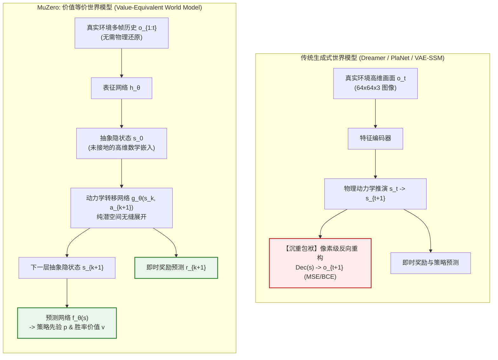
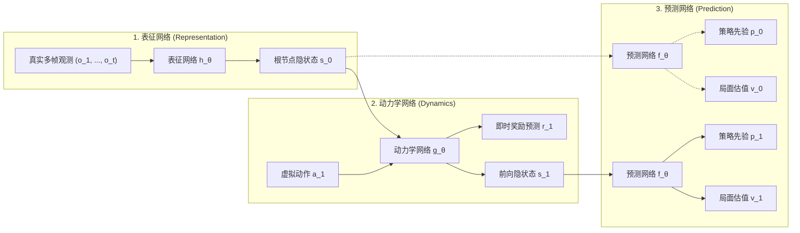
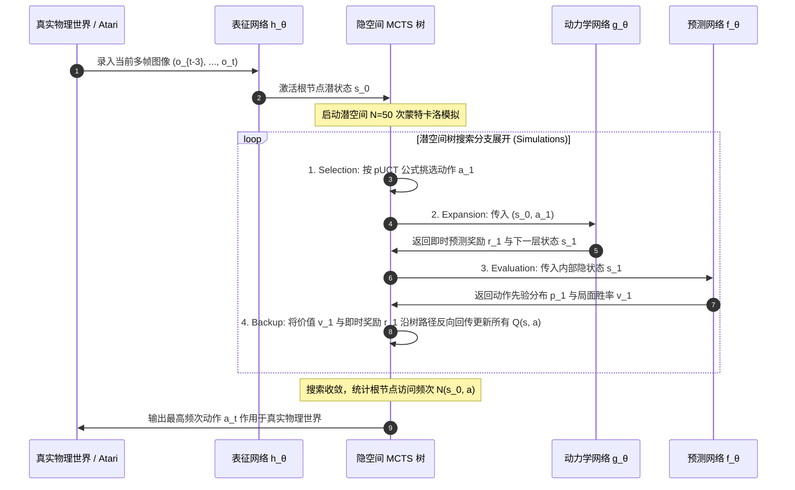
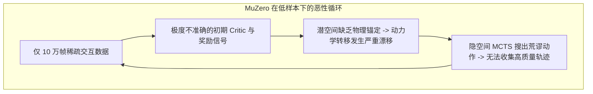
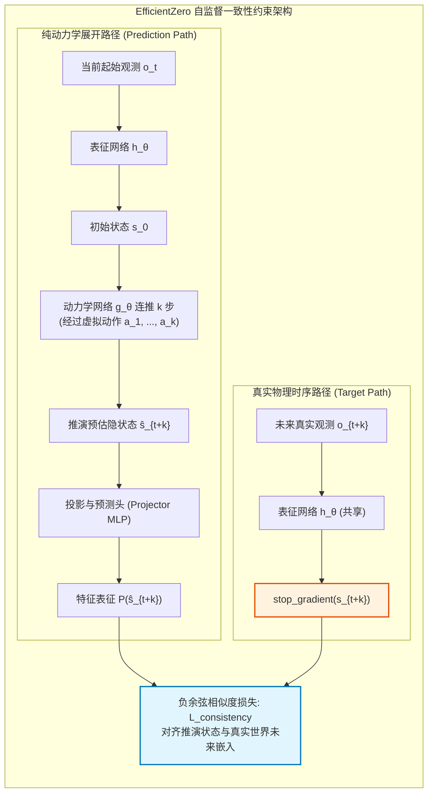

# 04. 价值等价动力学：MuZero 与 EfficientZero 的隐空间博弈

> **核心文献**：
> 1. **MuZero**: *Mastering Atari, Go, Chess and Shogi by Planning with a Learned Model* (Nature 2020) — Julian Schrittwieser, Ioannis Antonoglou, Thomas Hubert, Karen Simonyan, Laurent Sifre, Simon Schmitt, Arthur Guez, Edward Lockhart, Demis Hassabis, Thore Graepel, Timothy Lillicrap, David Silver  
> 2. **EfficientZero**: *Mastering Atari with Discrete World Models on 100k Benchmark* (NeurIPS 2021 Oral) — Weirui Ye, Shaohuai Liu, Thanard Kurutach, Pieter Abbeel, Yang Gao  
> **论文链接**：  
> - MuZero: https://www.nature.com/articles/s41586-020-03051-4  
> - EfficientZero: https://arxiv.org/abs/2111.00210  
> **核心地位**：开创了世界模型的第二大流派——**价值等价世界模型（Value-Equivalent World Models）**。彻底砸碎了“为了规划必须重构高维物理像素”的思想钢印，首次将 AlphaZero 强大的蒙特卡洛树搜索（MCTS）移植到完全未接地、无仿真器回滚（Simulator-free）的神经隐空间中；后续由清华与 UC Berkeley 团队提出的 EfficientZero 则引入自监督一致性，在 Atari 100k 极低样本基准上打破人类水平。

---

## 1. 核心哲学：“如果你只想在暴风雨中赢下棋局，就不要去计算天空中每一朵云彩的微观折射”

在 Dreamer、PlaNet 等主流生成式世界模型中，智能体为了推演未来，被强行赋予了一项沉重的包袱——**全像素物理重构（Full-Pixel Reconstruction）**。

然而，DeepMind 强化学习掌门人 David Silver 与 Sutton 在《价值等价模型原理》（*Value-Equivalent Models*）中提出了一个发人深省的哲学悖论：
- **微观物理复杂性与宏观因果决策的严重错位**：
  现实世界充斥着海量的**任务无关信息（Task-Irrelevant Distractors）**——雨滴撞击窗户的飞溅、树叶随风摆动的湍流、电视机屏幕上的随机雪花点、棋盘边缘的光斑衍射。
- **容量浪费陷阱**：
  如果一个世界模型将 95% 以上的参数容量与梯度更新，都耗费在如何像素级精准还原这些高频不可预测的微观噪点上，留给核心因果推理（“下这一步是否会被对手将死？”）的容量将被极度压缩。

**MuZero 的破局哲学**：彻底放弃像素解码器！世界模型不需要具备物理视觉还原能力，它只需要在隐空间中维持与真实物理世界在**策略分布（Policy $p$）、即时奖励（Reward $r$）和长程价值（Value $v$）**上的完全等价。只要一个潜状态能够准确指引赢棋，它在像素空间长成什么样根本无需关心！

---

## 2. MuZero 三大核心函数解构与端到端计算图

MuZero 的整体架构极致紧凑，仅由三个深度神经网络组合而成：

### 2.1 表征函数（Representation Function）$h_\theta$
负责将智能体过去经历的连续 $m$ 帧观测序列（例如连续 4 帧 Atari 画面或棋盘落子记录）压缩为 MCTS 根节点的抽象隐状态：
$$s_0 = h_\theta(o_1, o_2, \dots, o_t)$$
- **特性**：$s_0 \in \mathbb{R}^{C \times H \times W}$ 是一个未经接地的连续张量（例如 $6 \times 6 \times 256$ 的卷积特征图），它不具备可解释的 RGB 色彩通道，只保留了当前局面的因果与拓扑信息。

### 2.2 动力学函数（Dynamics Function）$g_\theta$
负责在未接地的潜空间中，根据前一时刻隐状态 $s_{k-1}$ 与假设动作 $a_k$，向前推演一步并预估即时奖励：
$$r_k, \, s_k = g_\theta(s_{k-1}, a_k)$$
- **关键细节**：$g_\theta$ 由带残差连接的卷积块或 ResNet 构建，输出被显式切分为两部分：
  1. 即时奖励概率分布 $r_k \in \mathbb{R}^{2k+1}$；
  2. 隐状态张量 $s_k$。该状态经由 Min-Max 尺度缩放后直接作为下一步动力学递归的输入。

### 2.3 预测函数（Prediction Function）$f_\theta$
负责对树搜索过程中的任意一个隐状态 $s_k$（无论是根节点还是深层虚构节点）进行战略价值与行动偏好的双头预测：
$$p_k, \, v_k = f_\theta(s_k)$$
- **策略先验向量 $p_k \in \mathbb{R}^{|\mathcal{A}|}$**：每个合法动作的先验选择概率，用于引导后续 MCTS 树分支的先验剪枝；
- **状态价值分布 $v_k \in \mathbb{R}^{2v+1}$**：从该隐状态出发直到最终对局结束的期望总累积折现回报。

---

## 3. 隐空间蒙特卡洛树搜索（Latent MCTS）：终结模拟器回滚依赖

### 3.1 从 AlphaZero 到 MuZero 的关键质变
在 AlphaGo 与 AlphaZero 中，MCTS 树搜索之所以能够顺畅展开，是因为其底层拥有一个由人类工程师使用 C++ 严格按照围棋/象棋规则写死的**完美精确环境模拟器**。
模拟器必须支持**快照（Snapshot）**与**时间回溯（Rewind）**功能：
- 沿着树向下试走 5 步落子；
- 估值完毕后，必须能瞬间把棋盘恢复到 5 步前的状态，以便尝试另一条分支。

然而在现实物理世界、机器人操作、高维复杂视频游戏（如《星际争霸》或 Atari）中，**根本不存在可以自由回滚的外部完美仿真器**！

**MuZero 的破局神技**：直接将神经网络动力学 $g_\theta$ 当作**完全神经化、原生支持无限分叉、任意复制、随意回滚的虚拟因果引擎**！

### 3.2 树搜索四大阶段数学形式化

1. **选择阶段（Selection via pUCT Rule）**：
   从根节点出发，在每个内部节点选择使得改良版上限置信区间（Predictor Upper Confidence Bound, pUCT）最大的动作分支：
   $$a^* = \arg\max_a \left[ Q(s, a) + P(s, a) \cdot \frac{\sqrt{\sum_b N(s, b)}}{1 + N(s, a)} \left( c_1 + \log\left(\frac{\sum_b N(s, b) + c_2 + 1}{c_2}\right) \right) \right]$$
   其中：
   - $Q(s, a)$ 为动作价值均值，经过树内已知最小最大值动态归一化至 $[0, 1]$ 之间；
   - $P(s, a)$ 为预测网络给出的先验概率，强行抑制盲目随机展开；
   - $N(s, a)$ 为该动作分支的访问计数；
   - $c_1 = 1.25, c_2 = 19652$ 为动态探索控制超参数。
2. **扩展与评估阶段（Expansion & Evaluation）**：
   当遍历到达树的叶子节点时，调用动力学网络 $g_\theta(s, a)$ 产生新的叶子隐状态张量 $s'$ 与奖励预测 $r'$，并调用预测网络 $f_\theta(s')$ 输出策略先验 $p'$ 与估值 $v'$，正式完成节点入树。
3. **回溯阶段（Backup）**：
   沿着当前模拟路径逆向返回，按折现率 $\gamma$ 递归更新路径上每个节点的折现收益，并更新访问频次 $N(s, a) \leftarrow N(s, a) + 1$ 与动作价值期望 $Q(s, a)$。
4. **决策执行（Action Selection）**：
   在完成预设次数（例如 50 次模拟）后，智能体不再依赖 Critic 的直接数值，而是根据根节点所有分支的**访问次数分布（Visit Count Distribution）**采样或选择最优动作：
   $$\pi_t(a) = \frac{N(s_0, a)^{1/\tau}}{\sum_b N(s_0, b)^{1/\tau}}$$
   在训练初期设置温度 $\tau = 1$ 进行充分探索；在测试部署阶段设 $\tau \to 0$ 贪心选择访问频次最高的动作。

---

## 4. 端到端多任务联合损失函数

MuZero 的网络参数 $\theta = \{\theta_h, \theta_g, \theta_f\}$ 通过一个涵盖 $K$ 步自回归潜空间展开的联合损失函数进行端到端联合反向传播：

$$\mathcal{L}(\theta) = \sum_{k=0}^K \left( \underbrace{l_r(u_{t+k}, r_k)}_{\text{奖励预测损失}} + \underbrace{l_v(z_{t+k}, v_k)}_{\text{价值预测损失}} + \underbrace{l_p(\pi_{t+k}, p_k)}_{\text{策略引导交叉熵}} \right) + c \|\theta\|_2^2$$

### 4.1 标量变换与交叉熵投影
为了处理棋类中 $\pm 1$ 与 Atari 中数万分数的极端跨度，MuZero 采用非线性压缩函数 $h(x)$：
$$h(x) = \text{sign}(x) \left(\sqrt{|x| + 1} - 1\right) + \epsilon x$$
所有的真实累积目标价值 $z_{t+k}$ 与实际奖励 $u_{t+k}$ 经过 $h(x)$ 映射后，再投射到离散分箱支持集（如 $[-300, +300]$ 的整数阶梯），利用离散交叉熵作为 $l_r$ 与 $l_v$，确保数值稳定。

---

## 5. EfficientZero：击破极低样本壁垒（Atari 100k 人类超越）

### 5.1 MuZero 的致命阿喀琉斯之踵：低数据下的“隐空间悬空”
MuZero 在数据极其充足的围棋和 2 亿步 Atari 上登峰造极，但在**极低数据样本（如 Atari 100k 基准：仅 10 万步交互，约合人类玩 2 小时）**下却全面溃败，表现甚至不如简单的无模型算法。

清华大学与 UC Berkeley 研究团队（Ye et al., NeurIPS 2021 Oral）深入解剖了其根本诱因：
- **表征未接地与漂移（Ungrounded Latent Drift）**：
  由于 MuZero 完全抛弃了像素重构，所有的表征监督信号**全部来自于自举（Bootstrapped）的价值与奖励**；
  在训练早期，智能体拿到的奖励绝大多数为 0，价值预测充满噪声。在缺乏底层物理视觉锚定的情况下，表征网络 $h_\theta$ 会迅速发生**潜空间表征漂移（Representation Drift）**甚至退化坍缩！

### 5.2 自监督时序一致性损失（Self-Supervised Consistency Loss）
为了在**不增加沉重像素解码器**的前提下，让隐状态死死锚定物理世界，EfficientZero 借鉴了自监督对比表征（SimSiam / BYOL）的非对称设计，提出了**时序自监督一致性机制**：

- **数学形式化**：
  令开环动力学递归展开 $k$ 步得到预测状态 $\hat{s}_{t+k}$，而真实未来帧经过编码器得到真实状态 $s_{t+k} = h_\theta(o_{t+k})$。
  一致性损失要求投影头预测出的向量与真实特征的最大化负余弦相似度：
  $$\mathcal{L}_{\text{consistency}} = -\sum_{k=1}^K \frac{\text{Proj}(\hat{s}_{t+k})^\top \cdot \text{stop\_grad}(s_{t+k})}{\|\text{Proj}(\hat{s}_{t+k})\|_2 \, \|\text{stop\_grad}(s_{t+k})\|_2}$$
  - **核心妙手**：使用 `stop_gradient` 切断目标支路，使得模型绝对不会通过把所有隐状态坍缩为常数零向量来作弊，在零像素重构成本下强行赋予了动力学模型极强的时空物理保真度！

### 5.3 价值前缀端到端修正（End-to-End Value Prefix）与优先经验重放
EfficientZero 进一步改进了 MCTS 展开中的长程折扣机制，将每一步递归预测的即时奖励聚合为连续价值前缀（Value Prefix），并将其深度融入多步 TD 目标计算中。

### 5.4 历史性登顶：Atari 100k 突破人类平均水平

| 算法模型 | 算法类型 | 是否重构像素 | Atari 100k 人类中位数归一化得分 (HNS) | 是否超越人类平均 (HNS > 100%) |
| :--- | :--- | :--- | :--- | :--- |
| **SimPLe (2019)** | 视频生成式世界模型 | 是 (严格重构画面) | 44.3% | 否 |
| **DreamerV2 (100k 调优)** | 离散 RSSM 梦境生成 | 是 (重构画面与奖励) | 59.8% | 否 |
| **MuZero (原生)** | 价值等价动力学 | 否 (纯价值驱动) | 35.1% | 否 (早期漂移严重) |
| **EfficientZero (2021)** | **价值等价 + 自监督一致性** | **否 (无需图像解码器)** | **109.0%** | **是 (历史首次突破人类水平)** |

在仅仅允许游戏 2 小时交互的残酷限制下，EfficientZero 以 109.0% 的中位数得分，成为强化学习历史上**首个在样本效率上全面压倒人类专家的通用算法**！

---

## 6. 横向大辩论：价值等价模型（MuZero） vs. 重构物理模型（Dreamer）

| 比较维度 | 价值等价流派 (MuZero / EfficientZero) | 物理重构流派 (Dreamer V1-V3 / PlaNet) | 根本机理差异 |
| :--- | :--- | :--- | :--- |
| **抗视觉噪声干扰** | **极高 (近乎免疫)** | 较弱 (极易被任务无关高频噪声分散容量) | MuZero 无像素重构项，自动滤除所有与奖励/胜率无关的浮光掠影。 |
| **策略推演上限** | **极强 (超人类竞技水准)** | 较强 (优秀控制，但在超复杂博弈上略逊) | 内部搭载了强大的启发式树搜索（MCTS），能够在推理时利用算力换取智能。 |
| **极端样本利用率** | **最高 (Atari 100k 霸榜)** | 极高 (但低样本需重构约束) | 自监督时序一致性（SimSiam）以极小代价锁死状态因果空间。 |
| **反事实与可解释性** | **极低 (完全黑盒)** | **极高 (可视化的梦境电影)** | MuZero 隐状态无法解码成画面，人脑无法直观审视其脑内想象；Dreamer 可随心所欲播放梦境视频。 |
| **跨任务无监督迁移** | 极弱 (特定任务绑定) | **极强 (任务无关世界物理先验)** | MuZero 隐空间紧密绑定在特定游戏的 Reward 目标上；Dreamer 学习的是世界本身的物理运转规律，哪怕任务奖励清零，依然可以利用物理模型进行下游探索。 |
| **实时控制推理延迟** | 较高 (每帧需执行 50+ 次 MCTS 展开) | **极低 (单次前向 Actor 网络直接吐出动作)** | MuZero 依赖在线树搜索；Dreamer 已将规划蒸馏进 Actor 参数中，具备百赫兹机器人控制潜力。 |
