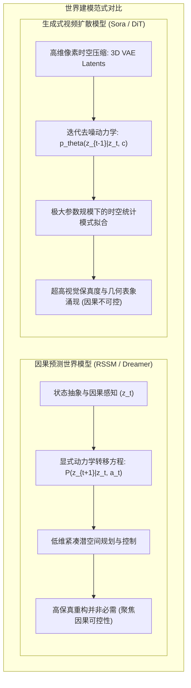
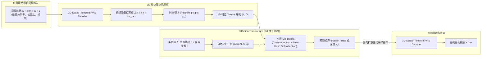
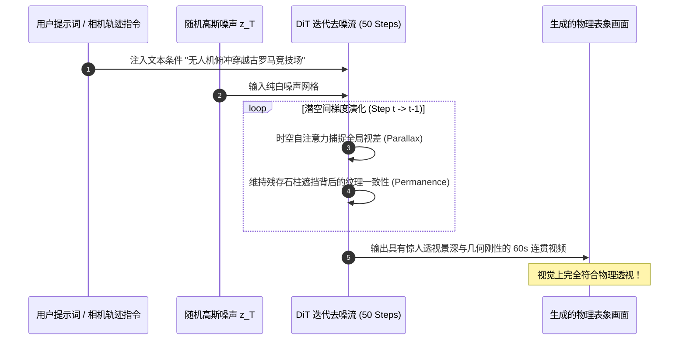
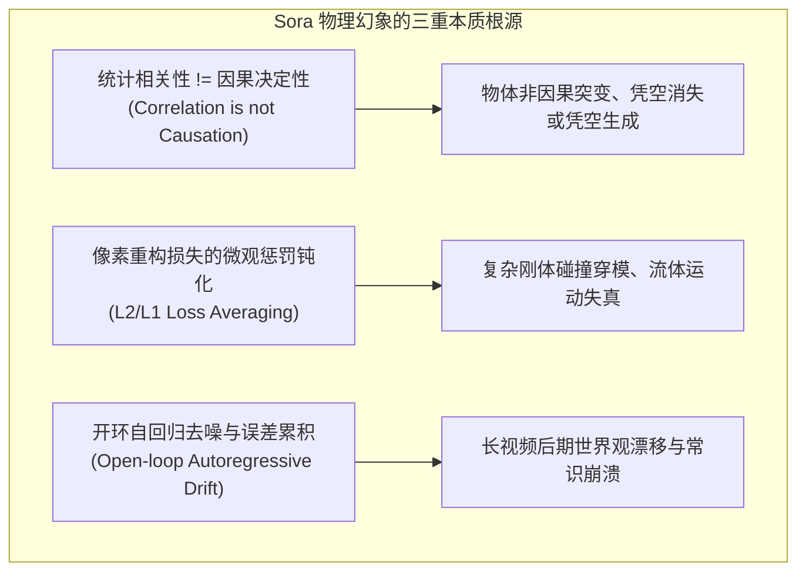

# 05. Sora 与视频扩散变换器（Video DiT）：作为“世界模拟器”的探索与幻象

> **论文与技术报告**：*Video Generation Models as World Simulators* (OpenAI Technical Report, 2024) / *Scalable Diffusion Models with Transformers (DiT)* (Peebles & Xie, ICCV 2023)  
> **核心定位**：生成式视频大模型的巅峰代表。通过将变长高维视频压缩至时空潜空间并结合 Diffusion Transformer 进行极大规模预训练，展现出逼真的三维空间连贯性与初步物理交互表象，引发了“生成式视频模型是否就是通用世界模拟器”的学术争鸣。

---

## 1. 形象比喻：严谨的“物理学家”与博闻强记的“神笔画师”

要理解 Sora 等视频扩散模型与传统控制论/强化学习世界模型（如 RSSM、Dreamer）的本质分歧，可以用一个形象的比喻：

- **传统世界模型（如 RSSM / Dreamer）是一位“严谨的物理学家”**：
  他的大脑里装的是状态转移方程、受力平衡方程与因果动力学。当他看到一个小球滚向斜坡时，他在潜意识里快速计算速度、摩擦因数、重力分量与碰撞冲量，以极小维度的抽象状态（位置、速度、接触标志位）推演未来。他的脑海或许画不出小球表面极其细腻的光影倒影，但他绝对知道小球在重力下必定加速下滚，绝不可能悬浮或凭空穿透木板。
- **Sora（Video DiT）是一位“博闻强记的神笔画师”**：
  他阅读过人类文明所有的视频记录（数以亿计的真实电影、生活录像、游戏渲染）。他拥有不可思议的高维模式匹配与画功：当给定“杯子从桌沿滑落”的文本提示时，他能以惊艳的 4K 质感一帧帧描绘出水晶玻璃的高光折射、桌面的木纹倒影，甚至摄像头后撤时的精准透视景深变化。然而，画师的大脑中**没有牛顿第二定律的显式方程，只有像素时空补丁之间的统计相关性概率分布**。因此，当杯子落地时，他可能画出杯子在碎裂前一瞬间奇异穿透了地板，或者流淌出的牛奶诡异地违背热力学第二定律回流聚集。

---

## 2. 核心架构拆解：从像素到时空 Token

Sora 的技术核心建立在两大支柱之上：**基于 3D 卷积的时空自编码器（Spatiotemporal VAE）** 与 **扩散变换器（Diffusion Transformer, DiT）**。

### 2.1 时空补丁（Visual Spacetime Patches）：视界的数据统一化

传统视觉大模型往往要求将输入图像或视频预先裁剪/缩放到固定分辨率（如 $256 \times 256$ 或 $512 \times 512$），这破坏了原始视频的构图比例并损失了宽屏动态细节。Sora 借鉴了 ViT 将图像切分为 Patch 的思想，将其拓展至时间维度，提出了 **时空视觉补丁（Spacetime Patches）**：

1. **3D 时空 VAE 编码压缩**：
   原始连续视频帧序列 $X \in \mathbb{R}^{T \times H \times W \times C}$ 首先经过空间与时间维度的非对称 3D 卷积网络压缩到低维潜空间：
   $$Z_0 = \mathcal{E}_{\text{VAE}}(X) \in \mathbb{R}^{t_l \times h_l \times w_l \times d}$$
   其中时间下采样倍率通常为 $4\times$ 至 $8\times$，空间下采样倍率为 $8\times$。这使得模型能在计算可行性范围内处理长达数十秒的视频。
2. **时空分块（Patchifying）与展平为 1D 序列**：
   将潜空间特征图按照时空块尺寸 $p_t \times p_h \times p_w$ 进行规则划分，每个小立体块包含 $p_t \cdot p_h \cdot p_w \cdot d$ 维特征。经线性投影映射为维度为 $D$ 的 Token 嵌入：
   $$L = \left(\frac{t_l}{p_t}\right) \times \left(\frac{h_l}{p_h}\right) \times \left(\frac{w_l}{p_w}\right)$$
   无论输入的原始视频长宽比是 $16:9$、$9:16$ 还是宽银幕 $2.35:1$，最终都会转化为长度为 $L$ 的标准 1D Token 序列进行统一处理。

### 2.2 扩散变换器（DiT）与 AdaLN-Zero 机制

DiT 彻底放弃了传统扩散模型依赖的 U-Net 骨干，采用纯粹的标准 Transformer 堆叠。其关键创新在于如何优雅、高效地将时间步 $t$ 与语义条件 $c$ 注入到注意力流中。

#### AdaLN-Zero（Adaptive LayerNorm with Zero Initialization）

在 DiT Block 中，时间步 $t$ 的嵌入向量 $e_t$ 与文本语义条件 $c$ 相结合，经过多层感知机（MLP）回归出每层 LayerNorm 的仿射变换参数（缩放因子 $\gamma$、偏移因子 $\beta$）以及残差分支的门控参数 $\alpha$：

$$[\gamma_1, \beta_1, \alpha_1, \gamma_2, \beta_2, \alpha_2] = \text{MLP}([e_t, c])$$

对于第 $l$ 个块的特征输入 $h_{l-1}$：

$$\hat{h}_{l-1} = \text{AdaLN}(h_{l-1}, \gamma_1, \beta_1) = (1 + \gamma_1) \odot \left( \frac{h_{l-1} - \mu}{\sigma} \right) + \beta_1$$

$$h'_{l-1} = h_{l-1} + \alpha_1 \odot \text{SelfAttention}(\hat{h}_{l-1}) + \text{CrossAttention}(\hat{h}_{l-1}, c)$$

$$\hat{h}'_{l-1} = \text{AdaLN}(h'_{l-1}, \gamma_2, \beta_2)$$

$$h_l = h'_{l-1} + \alpha_2 \odot \text{MLP}(\hat{h}'_{l-1})$$

**Zero Initialization 极关键工程设计**：在训练初始阶段，将预测门控参数 $\alpha_1, \alpha_2$ 的线性层权重与偏置全部初始化为 0。这意味着在训练刚开始时，每个 DiT Block 退化为一个恒等映射（Identity Mapping）：
$$h_l = h_{l-1}$$
这极大缓解了深度 Transformer 在初始阶段训练不稳定的问题，允许模型规模平滑扩展到数十亿甚至百亿级参数。

---

## 3. 扩散生成数学机理：连续流匹配与去噪演化

Sora 等前沿视频生成模型逐步从传统的离散步长 DDPM 转向基于常微分方程（ODE）的 **流匹配（Flow Matching）** 或连续时间高斯扩散（Continuous-time Diffusion）。

### 3.1 加噪前向过程

在潜空间 $z \in \mathbb{R}^D$ 中，定义数据分布 $z_0 \sim q(z_0)$ 与先验高斯噪声 $z_1 \sim \mathcal{N}(0, I)$。通过概率流（Probability Flow）构建介于两者之间的插值路径：

$$z_t = (1 - t) z_0 + t z_1, \quad t \in [0, 1]$$

其对应的时间导数（即向量场速度场，Velocity Field）为：

$$u_t(z_t | z_0, z_1) = \frac{d z_t}{d t} = z_1 - z_0$$

### 3.2 训练目标（Conditional Flow Matching Loss）

DiT 神经网络 $v_\theta(z_t, t, c)$ 的目标是拟合这个向量场。损失函数定义为条件流匹配的均方误差：

$$\mathcal{L}_{\text{CFM}}(\theta) = \mathbb{E}_{t \sim \mathcal{U}[0, 1], z_0 \sim q(z_0), z_1 \sim \mathcal{N}(0, I)} \left[ \left\| v_\theta(z_t, t, c) - (z_1 - z_0) \right\|_2^2 \right]$$

在传统 DDPM 形式下，去噪目标则等价为对注入噪声 $\epsilon$ 的最优估计：

$$\mathcal{L}_{\text{DDPM}}(\theta) = \mathbb{E}_{t, z_0, \epsilon \sim \mathcal{N}(0, I)} \left[ \left\| \epsilon - \epsilon_\theta(z_t, t, c) \right\|_2^2 \right]$$

通过在大规模视频数据上最小化该均方误差，模型学会了在任意噪声状态下，顺着时空注意力推导出的统计方向，将无序的高斯噪声一步步剥离还原为连贯的高维视频潜表征。

---

## 4. 物理法则的“表面涌现”机理

当训练算力（Compute Flops）和参数量跨越临界阈值时，DiT 表现出令人震惊的物理世界表面一致性：

| 涌现现象 | 视觉表现 | 底层统计拟合机理 |
| :--- | :--- | :--- |
| **3D 几何与多视角一致性** | 摄像机围绕车辆旋转 360 度时，车身线条与反光遵循刚体透视法则 | 模型在数千万个带有环视/运镜的视频片段中，强拟合了像素间的对极几何（Epipolar Geometry）与视差流动相关性 |
| **时空持久性（Object Permanence）** | 行人被大树遮挡数秒后，从大树另一侧走出，其衣着、背包颜色保持不变 | 全局时空 Self-Attention 机制在时间轴上维持了长程 Token 之间的强激活权重，使掩码信息在潜空间得到记忆保留 |
| **材质渲染与光学反射** | 霓虹灯在雨后潮湿地面上的扩散倒影、水面泛起的逼真涟漪 | 3D VAE 捕捉的高频纹理基底与去噪器学到的光追高维分布先验，重现了经典渲染方程（Rendering Equation）的统计映射 |

---

## 5. 致命缺陷：物理幻象、因果倒错与闭环不可行性

尽管视觉质量登峰造极，但将 Sora 称为“物理世界模拟器”在概念上存在严密的逻辑漏洞。学术界在深入测试后揭示了其本质局限：

### 5.1 典型物理翻车模式（Physics Breakdown Cases）

1. **接触与拓扑突变失效（Collision & Topology Violation）**：
   - *案例*：当一个人走向玻璃杯并推倒它时，玻璃杯常常在手指接触前数厘米就已经碎裂，或者手指直接穿模嵌入玻璃内部。
   - *根源*：模型学习的是“人伸手”与“碎玻璃”两类高频视觉模式的时间先后共现概率，完全没有“刚体接触应力超过极限抗拉强度”的因果判定机制。
2. **状态转移不可逆性缺失（Thermodynamic Violation）**：
   - *案例*：被咬了一口的汉堡，在下一秒人物咀嚼时，汉堡表面的缺口竟然平滑愈合了；蜡烛燃烧滴落的蜡油又倒吸回烛芯。
   - *根源*：无向扩散图模型对热力学第二定律（熵增方向）缺乏内在单向拓扑约束，仅仅是沿统计平滑流场生成最优补全。
3. **复杂流体力学与多刚体混沌混沌不可预测性**：
   - *案例*：水流注入非规则容器时，液体会不可思议地向外溢散，或水柱与气泡呈现非牛顿流体的离奇悬停。

### 5.2 决策闭环的工程死穴：高推理时延与开环属性

| 对比维度 | 决策类世界模型（如 Dreamer V3） | 视频扩散模型（如 Sora / SVD） |
| :--- | :--- | :--- |
| **潜状态维度** | 极小离散向量（$32 \times 32$ 类别隐变量） | 超大规模高维张量（数以万计的时空 Tokens） |
| **单步转移推理时延** | **$< 1 \text{ ms}$**（单次紧凑 GRU / MLP 前向计算） | **$> 1000 \text{ ms}$**（需迭代 20-50 次大型 DiT 前向去噪） |
| **动作交互可控性** | 显式高频控制接口（直接输入 $a_t \in \mathbb{R}^n$） | 弱文本引导/粗粒度轨迹条件，缺乏精确底层动作响应 |
| **下游规划适用性** | 可直接支撑 MCTS 搜索与 Actor-Critic 梦境回传 | 极高的计算代价导致无法展开长时程树搜索与策略闭环 |

**结论**：Sora 是一座卓越的**视觉渲染生成器（Generative Visual Renderer）**，它通过庞大的数据与算力暴力逼近了现实世界在二维投影下的视觉流形；但它不是也不可能直接成为可用于机器人具身决策与控制的**因果世界模型（Causal World Model）**。世界模型的未来演进必须突破纯像素级自回归扩散的藩篱，走向动作驱动的交互式环境与结构化表征。
