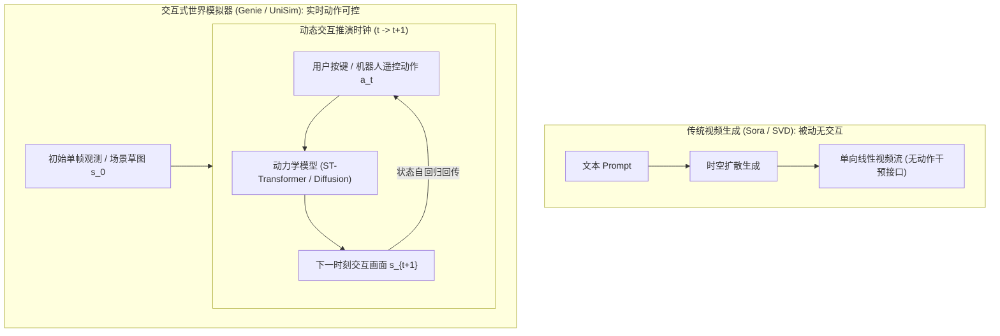
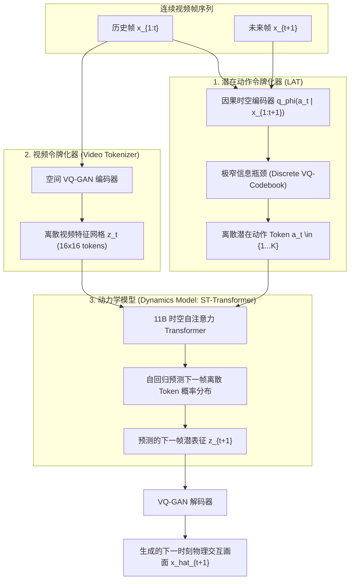
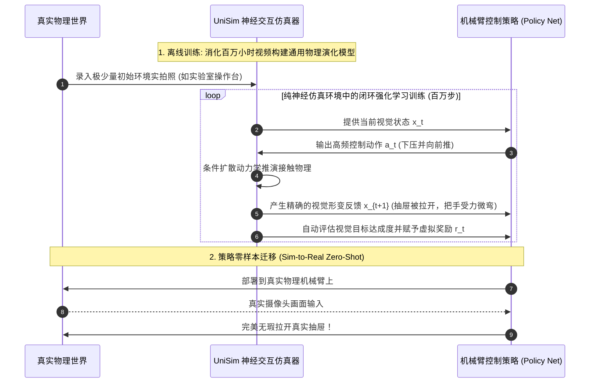

# 06. UniSim 与 Genie：交互式可控通用世界模拟器

> **论文与技术报告**：  
> - *Genie: Generative Interactive Environments* (Bruce et al., Google DeepMind, ICML 2024)  
> - *UniSim: A Universal Interaction Simulator for Learning Bounded and Actionable World Models* (Yang et al., Google DeepMind, ICLR 2024 Oral)  
> **核心定位**：打破互联网视频的“被动播放”枷锁，首次实现从海量无标注视频中自监督学习潜在动作并构建可实时操控的交互式虚拟世界，为具身智能与通用智能体提供了新一代端到端可交互“神经游戏引擎”。

---

## 1. 核心突破与形象比喻：将“被动录像带”逆向为“可插手柄的游戏机”

在 Genie 和 UniSim 诞生之前，计算机视觉与视频生成大模型（如 Sora、Runway）本质上扮演的是**单向广播电视**的角色：用户输入一段提示词，模型如放映幻灯片般单向输出几十秒渲染视频。坐在屏幕前的人无法按下“跳跃”或“前进”按键去实时干预视频中角色的下一步命运。

Genie 与 UniSim 实现了生成式 AI 的范式跃迁：
- **形象比喻**：
  想象一个黑客坐在电视机前，只通过观察上万部 1980 年代的红白机游戏通关录像带（没有任何玩家按键遥测记录，只有画面），自发推导出了：“*每当屏幕下方的人物突然向上位移并改变姿态时，背后必然存在一个特定的抽象动作指令（比如按下 A 键）；每当人物贴近管道下蹲时，背后必然对应另一个离散动作（按向下键）*”。
  不仅如此，黑客还根据这些画面之间的物理因果关联，用神经网络焊制出了一台“神经红白机”：你现在随手画一张草图或拍一张房间的照片喂给它，插上只有 8 个按键的虚拟手柄，你按下右键，草图里的角色就会立刻迈步右移；按下跳跃键，角色就会凌空跃起，周围的砖块与金币也会遵循交互物理规则产生动态反馈！



---

## 2. Genie 架构拆解：无监督动作发现的三位一体

Genie 最令人惊艳的学术突破在于：**在训练过程中从未接触过任何手柄按键、摇杆遥测或动作标签（No Action Labels）**，仅凭 200,000 小时的公开互联网 2D 平台游戏视频，便自监督发现了高度可控的 8 种离散动作语义。

Genie 架构由三个紧密咬合的核心模块构成：**潜在动作令牌化器（Latent Action Tokenizer, LAT）**、**视频令牌化器（Video Tokenizer）** 以及 **动力学模型（Dynamics Model）**。



### 2.1 潜在动作令牌化器（Latent Action Tokenizer, LAT）

LAT 的任务是将无标注视频帧对之间的变化压缩为单一的离散动作。

#### 理论机理与信息瓶颈设计

给定视频片段 $x_{1:T}$，若要推断时刻 $t$ 的动作 $a_t$，编码器必须遵守**时间因果性（Temporal Causality）**：计算动作 $a_t$ 时，网络只能访问当前帧及之前的过去帧，最多加上紧随其后的下一帧 $x_{t+1}$，严禁访问遥远未来的帧 $x_{>t+1}$：

$$q_\phi(a_t | x_{1:t+1})$$

为了防止模型“作弊”（例如将背景中微小的像素噪点或全局光照变化作为动作信息传递给解码器），LAT 强行引入了**极度狭窄的信息瓶颈（Drastic Information Bottleneck）**：
- 每一对相邻帧转移之间，只允许输出一个维度的离散类别索引 $a_t \in \{1, 2, \dots, K\}$（在 Genie 中，$K=8$）。
- 由于 $K=8$（即仅有 3 个 bits 的信息容量），模型在容量压力下，被数学迫使忽略静态背景、UI 数字变化，而**只能将宝贵的信息槽位用于编码整个画面中最显著的物体位移与交互主体的因果突变**。

#### VQ 离散量化数学形式

编码器首先输出连续隐向量 $u_t = \text{Enc}_\phi(x_{1:t+1}) \in \mathbb{R}^D$。在预设的离散码本 $\mathcal{C} = \{e_1, e_2, \dots, e_K\} \subset \mathbb{R}^D$ 中进行最近邻最近欧氏距离查找：

$$a_t = \arg\min_{k \in \{1, \dots, K\}} \| u_t - e_k \|_2$$

得到量化向量 $q_t = e_{a_t}$。为解决不可导问题，采用直通估计器（Straight-Through Estimator, STE）：

$$\tilde{q}_t = u_t + \text{sg}[e_{a_t} - u_t]$$

其中 $\text{sg}[\cdot]$ 为 Stop-Gradient 截断梯度算子。LAT 的联合优化目标函数为：

$$\mathcal{L}_{\text{LAT}} = \mathcal{L}_{\text{recon}}(x_t, \hat{x}_t) + \|\text{sg}[u_t] - e_{a_t}\|_2^2 + \beta \|u_t - \text{sg}[e_{a_t}]\|_2^2$$

第 1 项为未来帧重构损失；第 2 项（Codebook Loss）促使码本向量向编码器特征靠拢；第 3 项（Commitment Loss）防止连续编码输出肆意发散。

### 2.2 视频令牌化器（Spatiotemporal Video Tokenizer）

采用类似于 MaskGIT 或 VQ-GAN 的高效分词架构，将每一帧原始图像 $x_t \in \mathbb{R}^{H \times W \times C}$ 压缩为高密度离散整数网格 $z_t \in \{1, \dots, V\}^{h \times w}$（例如 $16 \times 16 = 256$ 个空间 Tokens，码本词表大小 $V=2048$）。

### 2.3 动力学模型（ST-Transformer）与时空解耦注意力

Genie 的动力学模型参数量高达 110 亿（11B）。由于长视频离散 Token 序列的自注意力计算复杂度随步数成平方级爆炸，Genie 采用了**时空解耦自注意力（Spatio-Temporal Transformer, ST-Transformer）**：

1. **空间自注意力（Spatial Attention）**：仅在当前时间步的 $16 \times 16$ 个网格 Token 内部进行全交互，复杂度为 $\mathcal{O}(T \cdot S^2)$，负责建模单帧内物体的局部几何与拓扑；
2. **因果时间自注意力（Causal Temporal Attention）**：跨时间轴在同一空间坐标的 Token 之间进行因果交互，复杂度为 $\mathcal{O}(S \cdot T^2)$，负责建模物理因果在时间上的顺延与累积。

模型自回归学习下一时刻视频 Token 的交叉熵极大似然损失：

$$\mathcal{L}_{\text{Dynamics}} = -\sum_{t=1}^T \sum_{i=1}^S \log P\left( z_{t, i} \mid z_{<t, :}, z_{t, <i}, a_{<t} \right)$$

在推理时，用户只需输入一张初始单帧图片（甚至是手绘草图），并随机按压虚拟动作键 $a_t \in \{1..8\}$，模型便能实时生成长时程、物理可控、可反复试错的互动游戏世界！

---

## 3. UniSim：统一异构具身交互世界模型

如果说 Genie 是 2D 动作可控的“神经街机”，那么 Google DeepMind 提出的 **UniSim（Universal Interaction Simulator）** 则是面向真实世界机器人操作的“通用具身物理沙盒”。

```mermaid
flowchart TD
    subgraph MultimodalInputs ["多源异构交互数据接入"]
        HumanVideo["人类日常交互视频 (Ego4D / 百万小时人类活动)"]
        RobotTelem["跨实体机器人轨迹 (RT-1 / Bridge 机械臂遥操作)"]
        TextDesc["高层语言指令 ('打开洗碗机并取出杯子')"]
    end

    subgraph ActionAbstraction ["统一动作空间映射 (Universal Action Layer)"]
        UniversalAction["统一交互控制表示 a \in A_text \cup A_discrete \cup A_continuous"]
    end

    HumanVideo & RobotTelem & TextDesc --> UniversalAction

    subgraph ConditionalDiffusion ["条件交互扩散世界模型 (UniSim Dynamics)"]
        CurrentObs["当前物理观测 x_t"] & UniversalAction --> DiffusionProcess["时空条件扩散去噪流: p_theta(x_{t+1} | x_t, a_t, c)"]
        DiffusionProcess --> FuturePhysics["下一时刻真实物理环境演化 x_{t+1}"]
    end

    subgraph DownstreamLoop ["具身策略闭环评估与零样本迁移"]
        FuturePhysics --> RLPolicy["机器人具身策略网络 (Robotics Policy)"]
        RLPolicy -->|执行新动作 a_{t+1}| UniversalAction
    end
```

### 3.1 跨领域数据与动作空间的大一统

传统机器人世界模型最大的瓶颈是：**真实机器人收集物理遥测数据的成本极高**。UniSim 的核心洞见是利用条件生成模型作为桥梁，将互不兼容的海量多源数据融合进统一分布：

1. **人类第一视角视频（Ego-centric Video）**：富含极端丰富的日常物理常识（开门、擦桌子、揉面团），但缺少机器人的精确力矩与六自由度位姿；
2. **多机构机器人数据集（Multi-robot datasets）**：包含精确的机械臂末端执行器动作（End-effector Cartesians $\Delta x, \Delta y, \Delta z, \Delta \text{yaw}, \text{gripper}$），但场景多样性受限于实验室；
3. **文本语言先验**：提供高阶任务目标语义约束。

UniSim 将动作空间建模为一个广义联合流形：
$$a \in \mathcal{A}_{\text{multimodal}} = \left( a_{\text{continuous}} \in \mathbb{R}^7 \right) \cup \left( a_{\text{discrete}} \in \{1 \dots K\} \right) \cup \left( c_{\text{text}} \in \mathcal{T} \right)$$

### 3.2 条件扩散动力学机制

UniSim 没有采用离散自回归，而是采用了**连续潜空间条件扩散模型**来生成下一帧：

$$\mathcal{L}_{\text{UniSim}}(\theta) = \mathbb{E}_{t, x_0, \epsilon \sim \mathcal{N}(0, I)} \left[ \left\| \epsilon - \epsilon_\theta(x_{t+1}^\tau; \tau, x_t, a_t, c) \right\|_2^2 \right]$$

其中 $\tau$ 为扩散时间步。这种机制赋予了 UniSim 对非刚体形变（如折叠衣物、揉搓海绵、液体流动）极高的渲染真实感，远超基于网格多边形的传统物理仿真器（如 Isaac Gym、MuJoCo）。

---

## 4. 具身智能闭环评估：In-Silico 策略训练与迁移

UniSim 与 Genie 最深远的现实意义在于作为具身智能体的**纯硅基飞行模拟器（In-silico Simulator）**：



- **解决 Sim-to-Real 鸿沟**：传统游戏引擎基于解析力学（Ray-casting / Convex Mesh），无法逼真表达织物柔性、粉末飞溅与真实反光；UniSim 的“真实世界视频流形生成”彻底消除了视觉层面的域漂移（Domain Gap）。
- **零成本安全边界探索**：机器人可以在虚拟世界里疯狂尝试打碎玻璃、拉断电线等危险操作，从而训练出极具鲁棒性的避险策略。

---

## 5. 横向对比：潜动作模型（Genie）与显式动作世界模型（Dreamer / RSSM）

| 核心维度 | Genie (潜在动作模型) | UniSim (多模态具身模型) | Dreamer V3 (显式 RSSM) |
| :--- | :--- | :--- | :--- |
| **动作信号性质** | **无监督发现的离散代号** ($a_t \in \{1..8\}$) | **多模态混合** (文本 + 连续位姿 + 离散) | **显式环境动作** ($a_t \in \mathbb{R}^d$，真实执行器指令) |
| **数据需求** | 纯被动互联网视频（无需任何遥测） | 混合数据（人类日常视频 + 机器人遥操作） | 交互转移元组 $(s_t, a_t, r_t, s_{t+1})$ |
| **底层动力学内核**| 11B Spatio-Temporal Transformer | 条件潜在扩散模型 (Conditional Diffusion) | 紧凑循环状态空间 (Recurrent State Space) |
| **推理速度与吞吐**| 慢（自回归逐 Token 预测，约数秒/帧） | 极慢（多步扩散去噪迭代，数十秒/秒） | **极快**（$< 1 \text{ ms}$，支持兆级潜步数想象）|
| **物理守恒性** | 弱（可能出现偶尔的穿模与物体瞬移） | 中（依靠大数据扩散先验近似物理规律） | 高（紧密锚定在低维物理状态转移上） |
| **应用重心** | 虚拟游戏创造、开放世界交互原型 | 具身智能 Sim-to-Real 策略预演 | 高性能工业与机器人实时闭环强化学习 |

**总结**：UniSim 与 Genie 代表了世界模型走向“无监督通用可交互”的开创性篇章。它们证明了人类不需要手工编写每一行物理引擎代码，神经网络完全可以通过对世界的被动“冷眼旁观”，自发顿悟出操控这个世界的无形按键。
