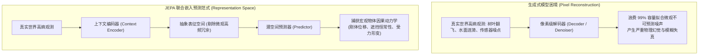
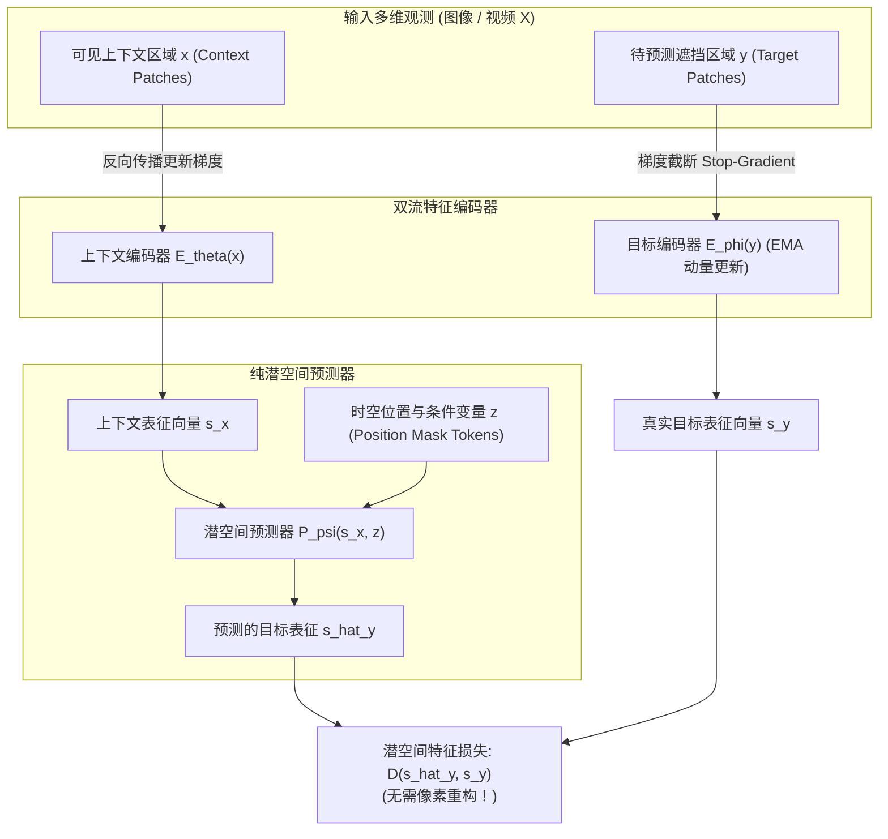
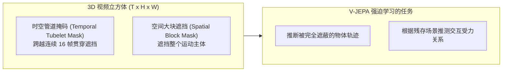
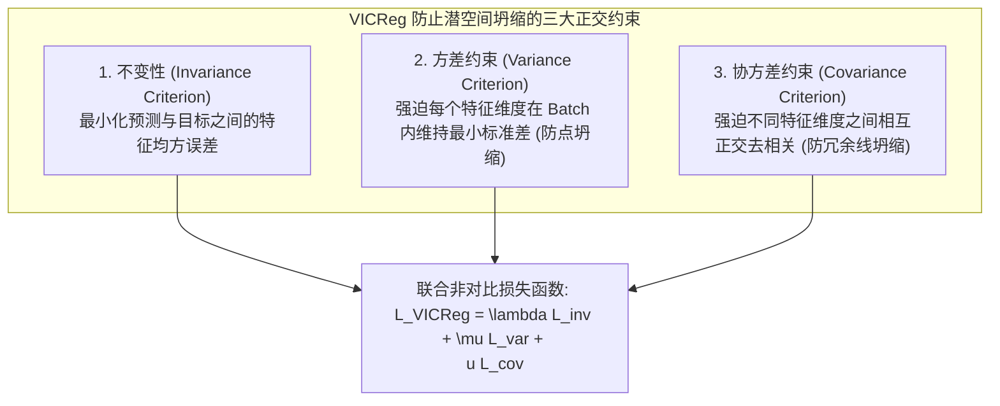

# 07. LeCun JEPA 与 V-JEPA：联合嵌入预测架构与非生成式世界模型

> **经典文献与研究**：  
> - *A Path Towards Autonomous Machine Intelligence* (Yann LeCun, OpenReview, 2022)  
> - *Self-Supervised Learning from Images with a Joint-Embedding Predictive Architecture (I-JEPA)* (Assran et al., Meta AI, CVPR 2023)  
> - *Revisiting Feature Prediction for Learning Visual Representations from Video (V-JEPA)* (Bardes et al., Meta AI, 2024)  
> - *VICReg: Variance-Invariance-Covariance Regularization for Self-Supervised Learning* (Bardes, Ponce, LeCun, ICLR 2022)  
> **核心定位**：图灵奖得主 Yann LeCun 提出的非生成式（Decoder-Free）世界模型核心纲领。主张彻底抛弃不可预测的微观像素重构，在高度抽象的潜变量表征空间中学习世界因果动力学与物理常识。

---

## 1. 核心哲学争鸣：“在暴风雨中预测每一片树叶是愚蠢的”

近年来以 Sora、Stable Video Diffusion、Pixel-level VAE 为代表的生成式模型风靡业界，但 Yann LeCun 尖锐地指出：**试图通过重构每一个像素来理解物理世界，是一条走向通用人工智能（AGI）的死胡同。**

### 1.1 树叶与暴风雨比喻（Leaves in a Windstorm）

想象你在暴风雨中观察一棵大树：
- **生成式像素模型（Generative / Autoencoding World Models）**：
  试图精确计算并绘制出树上几千片树叶在下一秒的像素坐标、微观反光和抖动轨迹。由于微观湍流在物理学上具有本原的不确定性（Irreducible Entropy），生成模型为了降低像素重建损失（MSE / L1），要么会输出一张所有树叶模糊成团的“平均灰雾”（均值回归坍缩），要么耗费 99% 的参数去幻想出逼真但毫不相关的树叶光影，从而**完全忽视了“这棵树是否会被连根拔起砸向电线杆”这一宏观因果本质**。
- **联合嵌入预测模型（JEPA）**：
  JEPA 彻底关掉了像素级的“投影仪”。它在抽象概念潜空间中进行推演：“*大树处于强受力弯曲状态，风向西北，下一时刻树干可能折断*”。至于每片树叶的绿色反光究竟偏向哪一个十六进制颜色码，JEPA 毫不在意。**丢弃不可预测的高频细节，只保留宏观物体的因果状态**，这才是人类婴儿感知世界的核心方式。

---

## 2. JEPA 架构全景与数学形式：潜空间因果三位一体

JEPA 彻底舍弃了像素解码器（Decoder-Free），其架构由三部分构成：**上下文编码器（Context Encoder $E_\theta$）**、**目标编码器（Target Encoder $E_\phi$）** 与 **潜空间预测器（Predictor $P_\psi$）**。

### 2.1 数学推导与非对称更新机制

给定输入信号 $X$（如图像或视频），将其划分为互不重叠的时空补丁。选择一部分区域作为可见上下文 $x$，另一部分区域作为待预测目标 $y$。

1. **上下文与目标特征提取**：
   $$s_x = E_\theta(x), \quad s_y = E_\phi(y)$$
2. **潜空间条件预测**：
   预测器接收上下文特征 $s_x$ 以及指示目标补丁时空坐标的查询掩码令牌（Mask Tokens）$z$，在表征空间预测目标的特征分布：
   $$\hat{s}_y = P_\psi(s_x, z)$$
3. **潜空间预测损失函数**：
   在特征空间直接计算 $L_1$ 或平滑 $L_1$（Smooth L1）范数：
   $$\mathcal{L}_{\text{JEPA}}(\theta, \psi) = \frac{1}{|y|} \sum_{i \in y} \left\| \hat{s}_{y, i} - s_{y, i} \right\|_1$$
4. **EMA 动量更新（Exponential Moving Average）**：
   为防止目标编码器与上下文编码器在反向传播中互相追逐导致崩溃，**目标编码器 $E_\phi$ 不接收来自 $\mathcal{L}_{\text{JEPA}}$ 的梯度更新**（$\text{sg}[\cdot]$ 梯度截断），而是通过指数移动平均平滑追踪上下文编码器参数 $\theta$：
   $$\phi \leftarrow \tau \phi + (1 - \tau) \theta, \quad \tau \in [0.996, 1.0)$$

---

## 3. V-JEPA 时空管道掩码（Spatiotemporal Tubelet Masking）

在图像领域（I-JEPA），掩码只是二维平面的矩形块。但在视频动力学领域（V-JEPA），时间维度的连续性带来了巨大的挑战：相邻帧之间的像素具有极高的光流连续性。

如果采用简单的随机时空点状掩码，网络只需抄袭前后紧邻帧的对应位置像素，通过简单的差值即可作弊得分，而根本学不到宏观物理因果。

### 3.1 遮挡策略核心规范

1. **时空管道掩码（Tubelet Masking）**：
   以空间尺寸 $p \times p$ 为截面，沿着时间轴 $T$ 强行贯穿遮挡连续多个时间步（例如连续 16 帧完全不给看）。
2. **极高遮挡比例（Masking Ratio）**：
   V-JEPA 将视频中高达 **70% 到 85%** 的时空 Token 完全遮蔽，仅暴露极少量的可见碎片。
3. **被迫领悟物理动力学**：
   在这种极其严苛的遮挡下，模型要想在潜空间正确预测出遮挡区域的高维语义特征，必须在内部自发建立起：
   - 运动加速度与重力抛物线模型；
   - 物体在遮挡物后方匀速移动的几何恒常性；
   - 接触形变与动作意图的深层因果链。

---

## 4. 表征坍缩防护盾：非对比学习与 VICReg 机理

在没有像素重构解码器约束的架构中，存在一个致命的数学平庸解：**表征坍缩（Representation Collapse）**。即编码器将所有的输入视频和图像无论内容为何，全部映射为一个恒定的常数向量 $\mathbf{0}$，此时预测损失 $\mathcal{L}_{\text{JEPA}} \equiv 0$ 恒成立。

传统的自监督对比学习（如 SimCLR、InfoNCE）通过强行引入大量的“负样本对”（Negative Pairs）来排斥不同样本以防止坍缩，但负样本构造开销巨大且存在语义冲突。LeCun 团队提出了彻底抛弃负样本的 **VICReg（Variance-Invariance-Covariance Regularization）**。

### 4.1 VICReg 数学严格表述

设批次大小为 $N$，输出特征向量维度为 $d$。批次特征矩阵表示为 $Z \in \mathbb{R}^{N \times d}$，其对应的预测矩阵为 $\hat{Z} \in \mathbb{R}^{N \times d}$。

#### 1. 不变性损失（Invariance Loss）
度量对应潜变量的一致性：
$$\mathcal{L}_{\text{inv}}(Z, \hat{Z}) = \frac{1}{N} \sum_{i=1}^N \| z_i - \hat{z}_i \|_2^2$$

#### 2. 方差正则项（Variance Regularization - 解决点坍缩）
强迫每一维特征 $j \in \{1, \dots, d\}$ 在批次样本间的标准差 $S(Z_{:, j}, \epsilon)$ 不低于预设边界 $\gamma$（通常取 $\gamma = 1$）：
$$S(Z_{:, j}, \epsilon) = \sqrt{\frac{1}{N-1} \sum_{i=1}^N (z_{i, j} - \bar{z}_j)^2 + \epsilon}$$
$$\mathcal{L}_{\text{var}}(Z) = \frac{1}{d} \sum_{j=1}^d \max\left(0, \gamma - S(Z_{:, j}, \epsilon)\right)$$
**物理意义**：如果编码器试图将所有样本输出同一个常数，其方差会骤降至 0，从而触发巨大惩罚，强迫潜空间均匀散开。

#### 3. 协方差去相关项（Covariance Regularization - 解决维度冗余与线坍缩）
特征即使方差不为 0，也可能所有维度高度线性相关（所有特征退化在一条斜线上）。协方差矩阵定义为：
$$C(Z) = \frac{1}{N-1} \sum_{i=1}^N (z_i - \bar{z})(z_i - \bar{z})^\top \in \mathbb{R}^{d \times d}$$
损失函数强行拉平非对角线元素（Off-diagonal Terms）：
$$\mathcal{L}_{\text{cov}}(Z) = \frac{1}{d} \sum_{i \ne j} [C(Z)]_{i, j}^2$$
**物理意义**：强迫潜变量的每个分量相互正交，独立编码不同的物理属性（如分别编码质心速度、旋转角速度、表面反光率），实现信息容量的最大化。

---

## 5. 跨流派深度横向对比：生成式像素世界模型 vs JEPA 潜变量世界模型

| 评测维度 | 生成式世界模型（如 Sora / Dreamer 重构流） | 联合嵌入预测模型（LeCun JEPA / V-JEPA） |
| :--- | :--- | :--- |
| **预测空间** | 像素空间 / 3D VAE 密集网格（Pixel/Patch Latent） | **高度抽象的语义潜空间（Representation Space）** |
| **解码器（Decoder）**| 必须配备高参数量像素/视频解码器（U-Net / DiT） | **彻底无解码器（Decoder-Free）**，零像素渲染开销 |
| **抗微观噪声能力** | 极弱（极易被地毯纹理、水面微波、树叶扰乱） | **极强**（高频微观不可预测噪声被编码器自然过滤） |
| **多模态不确定性处理**| 依靠高斯噪声注入与多步扩散采样 | 引入紧凑潜在隐变量 $z$，表征预测分支流形 |
| **物理常识捕捉** | 表面光影拟合极佳，但接触穿模、因果颠倒频发 | 专注于宏观因果位移与拓扑遮挡，具备更强的因果鲁棒性 |
| **下游任务接口** | 需要额外的特征提取器，或直接对生成画面再编码 | **开箱即用（Zero-shot Ready）**，提取的表征直接服务于控制与分类 |

**结论**：V-JEPA 揭示了世界模型的另一条进化圣杯：**世界模型不等于视频播放器**。智能体在物理世界中做出明智决策，并不需要一双能把未来画成电影的画笔，而需要一颗能够洞察事物本质因果联系的抽象大脑。
