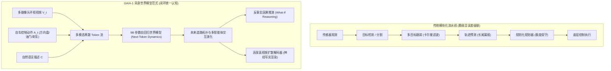
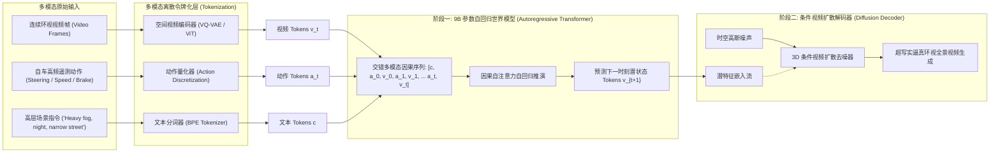
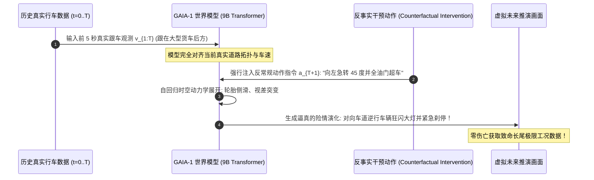
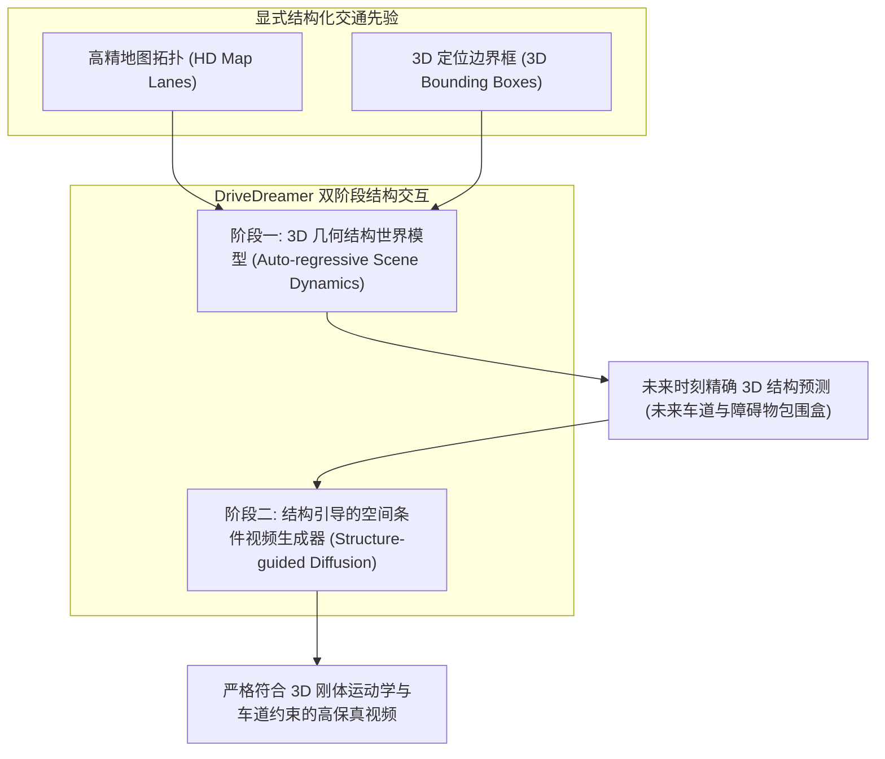

# 08. GAIA-1 与 DriveDreamer：具身自动驾驶世界模型与反事实仿真

> **经典文献与研究**：  
> - *GAIA-1: A Generative World Model for Autonomous Driving* (Hu et al., Wayve, 2023)  
> - *DriveDreamer: Towards Real-world-driven World Models for Autonomous Driving* (Wang et al., CVPR 2024 / arXiv 2023)  
> - *World Models for Autonomous Driving: An Embodied AI Perspective* (Wayve Tech Blog, 2023)  
> **核心定位**：自动驾驶由“感知-预测-规划”传统模块化规则堆栈，向“具身多模态世界模型”端到端演化的里程碑式代表。首次在大规模真实自动驾驶数据上跑通多模态动作注入、长程时空几何演化、高保真视频解码与反事实（What-If）推演。

---

## 1. 范式革命：从“规则级联接力队”到“具身心智老司机”

过去十余年，主流自动驾驶技术方案依赖于高度工程化的**模块化流水线（Modular Pipeline）**：
$$\text{Sensor Inputs} \longrightarrow \text{Perception} \longrightarrow \text{Tracking} \longrightarrow \text{HD Map Routing} \longrightarrow \text{Prediction} \longrightarrow \text{Planning} \longrightarrow \text{Control}$$

这种传统架构面临着三大无法根除的系统性危机：
1. **误差级联放大（Error Compounding Cascade）**：前级感知模块将阴雨天反光的塑料袋轻微漏检或将树影误判为障碍物，后级跟踪与规划模块就会产生激进刹车或危险避让；
2. **长尾极端工况穷尽不能（Long-tail Corner Cases Impossibility）**：现实世界中致命的交通事故、横穿逆行、道路坍塌属于十亿公里级的低概率事件，真实路测车队不仅极难采集，而且安全员绝不允许主动撞击；
3. **传统仿真器的 Sim-to-Real 鸿沟**：基于游戏物理引擎（如 CARLA）的仿真器充斥着生硬的 3D 网格模型，缺乏真实世界的复杂光影反射、雨雾遮蔽与非刚体行人的生物力学自然反应。

**GAIA-1 与 DriveDreamer 的突破，是把车变成一个“拥有物理心智的具身智能体”**：
- **形象比喻**：
  传统方案像 6 个聋哑工程师通过纸条接力指挥一辆车；而 GAIA-1 是一位拥有百万公里驾龄的老司机坐在方向盘后：
  双眼观察多路环视路况，大脑以毫秒级自发进行潜意识推演：“*如果我现在向右轻打半圈方向盘并给油超车，右侧盲区的红色小轿车会不会加速关门？如果前方卡车掉落货物，路肩是否有足够逃生抓地力？*”——**将多模态感知、自车动作因果律、交互博弈与多视界渲染熔铸为一个统一的自回归世界模型**。

---

## 2. GAIA-1 架构全景：分层生成与多模态令牌化

GAIA-1 采用了精妙的**两阶段解耦设计（Decoupled Two-Stage Generation）**：
- **第一阶段（自回归世界模型）**：负责在大规模低频潜空间中推演道路几何、博弈因果与动态场景拓扑；
- **第二阶段（条件视频扩散模型）**：负责将抽象潜空间解码为高保真、多视角、时间连贯的真实环视画面。

### 2.1 多模态令牌化（Multimodal Tokenization）与信息抽象

1. **视频离散令牌化（Video Tokenizer）**：
   使用在海量驾驶数据上预训练的空间 VQ-GAN 编码器，将分辨率为 $H \times W$ 的环视摄像头图像下采样为 $h \times w$ 个离散索引向量：
   $$v_t = \mathcal{E}_{\text{img}}(x_t) \in \{1, 2, \dots, V\}^{h \times w}$$
   其中码本尺寸 $V=8192$。空间降采样因子为 $8\times$，这极大地压缩了时空序列长度，使自回归注意力能够跨越数十秒进行推演。
2. **动作令牌化（Action Discretization）**：
   自车执行的物理遥测信号包含连续量：方向盘转角 $\delta_t \in [-\pi, \pi]$、油门开度 $th_t \in [0, 1]$、刹车制动压力 $br_t \in [0, 1]$、车速 $v_t$ 和横摆角速度 $\omega_t$。
   GAIA-1 将高维连续动作空间通过均匀网格或聚类量化为具有明确物理刻度的离散动作词表 $a_t \in \{1, \dots, A\}$。
3. **文本语义令牌化（Text Tokenizer）**：
   通过标准语言分词器处理文本提示，用于全局控制天气环境（暴雨、大雪、逆光日落）或引入不可预见的长尾事件（“前车突然急刹掉落轮胎”）。

### 2.2 自回归世界模型动力学：因果 Next-Token 预测

自回归模型包含高达 90 亿（9B）参数。它将多模态 Token 排布为具有强因果拓扑的时钟序交错序列：

$$S = [c, a_1, v_1, a_2, v_2, \dots, a_T, v_T]$$

在时间步 $t$，模型必须在**知晓历史所有视觉观测 $v_{<t}$ 与截至当前自车所做出的决策动作 $a_{\le t}$** 的前提下，预测下一时刻的视频特征网格：

$$\mathcal{L}_{\text{AR}}(\theta) = -\sum_{t=1}^T \sum_{i=1}^{h \times w} \log P_\theta\left( v_{t, i} \mid v_{<t}, a_{\le t}, c, v_{t, <i} \right)$$

通过这个无监督交叉熵预测任务，大型 Transformer 自发掌握了：
- **道路刚体动力学**：转向角越大，视频 Tokens 中车道线向内侧弯曲的弧度越剧烈；
- **自车加速度与视差光流**：踩下油门时，周围街景向两侧后退扩散的速度按透视几何规律精准加快；
- **智能体博弈（Agent Behavior Modeling）**：推演行人在斑马线边缘的驻足与避让意图，推演前车尾灯变红时的减速趋势。

### 2.3 条件视频扩散解码器（Video Diffusion Decoder）

自回归模型生成的 Tokens 位于离散语义特征空间，缺少毛孔级的视觉真实感。GAIA-1 引入了一个条件扩散模型，将世界模型预测的离散 Token 映射回连续高保真 RGB 空间：

$$\mathcal{L}_{\text{diff}}(\psi) = \mathbb{E}_{k, x_0, \epsilon \sim \mathcal{N}(0, I)} \left[ \left\| \epsilon - \epsilon_\psi(x_k; k, v_{t+1}, c) \right\|_2^2 \right]$$

该解码器不仅能生成单路主驾驶视角，还能同时生成时间高度同步的多路环视摄像头视频，支持动态光影折射、雨天挡风玻璃水珠与雨刷摆动的超写实还原。

---

## 3. 核心杀手锏：反事实推演（Counterfactual "What-If" Simulation）

在现实世界中，自动驾驶系统若想测试“如果我在此刻不减速而是直接强行超车会发生什么”，其代价可能是车毁人亡。而 GAIA-1 的核心魅力在于其强大的**因果反事实推演能力**。

### 3.1 反事实推演的因果干预机理

在 Pearl 因果推断理论框架下，反事实推演等价于对动作节点施加 $\text{do}(A = a')$ 算子：
1. **冻结历史认知状态（Abduction）**：
   将世界模型推演至当前关键岔路口时刻 $t$，保持上下文隐状态记忆（道路结构、周边车辆坐标、自车当前速度惯性）；
2. **强制干预动作输入（Action Intervention）**：
   用完全违背人类专家记录的动作 $a'_t$（如在红灯前地板油冲刺、在高速弯道猛打反向方向盘）替换原始动作；
3. **前向物理展开（Prediction）**：
   世界模型根据学到的物理常识与交互规律，自洽地展开未来时空流形：自车底盘在惯性下的打滑侧倾、护栏被撞击挤压的形变破损、甚至对向车道社会车辆的主动避撞变道，均能逼真涌现。

---

## 4. DriveDreamer：结构化先验与几何物理约束的融合

Wayve 的 GAIA-1 偏向于纯无监督端到端多模态大模型，而 **DriveDreamer** 则针对工业落地提出了**显式 3D 结构化物理约束（Structural Prior Alignment）** 的增强方案：

- **解决纯视觉模型的空间漂移**：纯自回归模型在推演几十秒后，道路边缘线或远方车辆偶尔会发生微小的非物理膨胀变形；DriveDreamer 通过将 3D 边界框轨迹与车道线作为显式条件输入，**确保了生成的交通参与者绝不发生违反三维刚体运动学的穿模或悬浮**。

---

## 5. 闭环决策集成：世界模型作为下游端到端规划器的“数字考官”

GAIA-1 绝非仅仅是一个炫酷的视频生成器，它正成为下一代端到端自动驾驶（End-to-End AD）的核心训练底座：

| 应用场景 | 传统自动驾驶开发模式 | GAIA-1 世界模型赋能模式 |
| :--- | :--- | :--- |
| **策略评测（Evaluation）** | 依赖昂贵的实车路测车队，数月才能积累一次偶发险情 | 在纯云端潜空间并行展开数万个反事实平行世界，**数分钟完成数亿公里极端工况压力测试** |
| **长尾训练（Corner-Case RL）** | 无法训练危险防碰撞边界策略（出于安全伦理禁区） | 模型在世界模型生成的无限次翻车、侧滑、横穿险情中无损试错，**通过闭环 RL 训练出神级救车反应** |
| **模型预测控制（Latent MPC）** | 在手工编写的粗糙物理模型上进行采样优化 | 直接在世界模型的隐状态流形中进行多步轨迹展开与碰撞风险打分，**实现真正的人性化博弈驾驶** |

**结语**：GAIA-1 与 DriveDreamer 的问世，宣告了具身自动驾驶正式迈入“世界模型时代”。自动驾驶系统的智能上限，不再取决于人工手写了多少条 if-else 规则，而取决于其脑海中的世界模型究竟能对现实物理时空产生多深邃的理解与预知。
