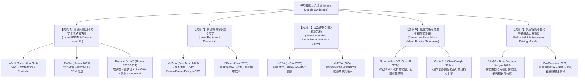
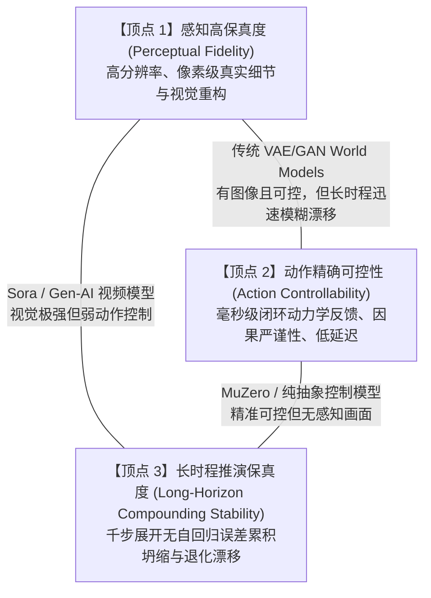

# 世界模型（World Models）全景体系研究与横向测评报告

> **执行周期**：多智能体联合深度研究与测评项目  
> **报告定位**：全景技术解构、数学机理剖析、工程选型指南与全维度横向基准测评  
> **工作目录**：`e:/code/Crafter/world_models_research`

---

## 目录
1. [引言：什么是世界模型？为什么世界模型是迈向 AGI 的核心基石？](#1-引言什么是世界模型为什么世界模型是迈向-agi-的核心基石)
2. [世界模型的认知学基础与控制论哲学](#2-世界模型的认知学基础与控制论哲学)
3. [世界模型全景技术演进图谱与流派划分](#3-世界模型全景技术演进图谱与流派划分)
4. [核心设计构件与数学解构框架](#4-核心设计构件与数学解构框架)
5. [世界模型“不可能三角”（The World Model Trilemma）](#5-世界模型不可能三角the-world-model-trilemma)
6. [八大代表性世界模型快速横向速览](#6-八大代表性世界模型快速横向速览)
7. [报告组织结构与深度研究指南](#7-报告组织结构与深度研究指南)

---

## 1. 引言：什么是世界模型？为什么世界模型是迈向 AGI 的核心基石？

在人工智能与认知科学中，**世界模型（World Model）**指的是智能体内部构建的、对外部物理或虚拟环境的运转机制、因果规律、时空动态进行内部表征与模拟的心智计算系统（Mental Simulation Engine）。

传统 Model-Free（无模型）强化学习（如 DQN、PPO、SAC）将环境视为一个黑盒反应堆：智能体通过海量试错盲目探索，直接学习从高维输入（如图像像素）到动作的映射。这种范式存在致命缺陷：
- **极度的样本低效（Sample Inefficiency）**：需要数千万乃至数十亿步环境交互才能学会简单动作；
- **真实物理交互的高昂代价与危险性**：自动驾驶汽车无法通过“撞车十万次”来学会避障，精密机械臂更承受不起反复硬碰撞造成的设备损耗；
- **缺乏反事实推理（Counterfactual Reasoning）能力**：无法在动作发生前思考“如果我采取这个动作，未来5秒会发生什么？”。

**世界模型彻底重构了这一范式**：智能体在观察外部世界的过程中，自主学习并建立一个“数字孪生版”的环境模拟器。一旦掌握了该模型，智能体便可**“闭上双眼，在自身梦境（Latent Space Imagination）中进行成千上万次的推演、探索与规划”**，从而实现人类级别的样本利用率、先见之明（Foresight）与常识物理理解。

```mermaid
flowchart LR
    subgraph RealWorld ["外部真实世界 / 物理环境 (Expensive & Slow)"]
        Env["环境状态转移 s_t -> s_{t+1}"]
    end

    subgraph WorldModel ["智能体心智内部：世界模型 (Cheap, Fast & Differentiable)"]
        direction TB
        Enc["感知编码器 (Encoder / V)"] --> Latent["隐空间抽象状态 z_t"]
        Latent --> Trans["时序动力学预测 (Transition / M)"]
        Trans --> FutureLatent["未来隐状态预演 z_{t+1}, ..., z_{t+K}"]
        FutureLatent --> RewPred["奖励 / 价值预估 (Reward/Value)"]
        FutureLatent --> Dec["反向解码重构 (Optional Decoder)"]
    end

    subgraph Policy ["决策大脑 (Actor-Critic / Planning)"]
        Planner["潜空间规划 / 纯梦境策略训练"]
    end

    Env -->|稀疏真实观测 o_t| Enc
    Planner -->|纯内部动作演练 a_{t:t+K}| Trans
    RewPred -->|内部梯度反向传播 / 树搜索| Planner
    Planner -.->|最终最优动作 a_t| Env
```

---

## 2. 世界模型的认知学基础与控制论哲学

世界模型的哲学根基源自控制论与认知神经科学的奠基理论：

### 2.1 康纳特-阿什比定理（Conant-Ashby Theorem, 1970）
> *"Every good regulator of a system must be a model of that system."*  
> （任何一个系统的良好调控器，必然是该系统的模型。）

该定理从控制论层面严格证明了：任何一个期望在多变环境中长期维持稳定、完成复杂调控目标的智能体，其最优内部控制策略必定在形式上同构于环境的模型。

### 2.2 自由能原理与预测编码（Free Energy Principle & Predictive Coding）
由神经科学家 Karl Friston 提出：生物大脑本质上是一个**多层级预测推理引擎**。大脑并不被动等待外界光子刺激输入，而是持续自顶向下（Top-Down）生成对外界感觉输入的预测先验；自底向上（Bottom-Up）传递的仅仅是**预测误差（Prediction Error）**。智能体的生存与学习目标，就是通过调整内部模型参数或采取行动改变感知，从而最小化变分自由能（Variational Free Energy）。

---

## 3. 世界模型全景技术演进图谱与流派划分

过去几十年中，世界模型从经典的线性状态空间卡尔曼滤波，演进至当今由深度神经网络、扩散 Transformer 支撑的高维复杂系统。当前世界模型已分化出五大核心流派：



---

## 4. 核心设计构件与数学解构框架

任何一个严谨的世界模型，均可被分解为以下四个核心算子：

$$\mathcal{WM} = \{\mathcal{E}_{\text{rep}}, \mathcal{T}_{\text{dyn}}, \mathcal{P}_{\text{plan}}, \mathcal{L}_{\text{obj}}\}$$

### 4.1 表征编码算子（Representation / Encoder）$\mathcal{E}_{\text{rep}}$
- **功能**：将高维、充斥感知冗余的原始观测 $x_t \in \mathbb{R}^{H \times W \times C}$ 压缩映射到低维紧凑的潜变量空间 $z_t \in \mathcal{Z}$。
- **主流范式**：
  1. **连续高斯隐空间**：$z_t \sim \mathcal{N}(\mu(x_t), \sigma^2(x_t))$（如 World Models、PlaNet、DreamerV1）；
  2. **离散分面隐空间（Categorical / Vector-Quantized）**：$z_t \sim \prod_{i=1}^N \text{Cat}(\phi_i(x_t))$（如 DreamerV2/V3、Genie）；通过直通估计器（Straight-Through Estimator）或 Gumbel-Softmax 反传，极大地遏制隐空间坍缩并精准捕获不连续的物理事件（如物体碰撞接触）。
  3. **非生成式自监督特征嵌入**：$s_t = f_\theta(x_t)$（如 V-JEPA、MuZero），彻底抛弃像素解码器，直接抽取高层语义拓扑。

### 4.2 动力学转移算子（Transition / Dynamics Predictor）$\mathcal{T}_{\text{dyn}}$
- **功能**：在潜空间中模拟物理规律的时序演变：给定当前历史状态与选定动作 $a_t$，推演下一时刻的未来状态。
- **主流范式**：
  1. **递归状态空间模型（RSSM, Recurrent State-Space Model）**：结合确定性记忆通路 $h_t = \text{GRU}(h_{t-1}, z_{t-1}, a_{t-1})$ 与随机不确定性通路 $z_t \sim p(z_t | h_t)$，兼顾长周期确定性记忆与多模态不确定性发散。
  2. **自回归 Transformer / Spacetime DiT**：将潜状态离散 Token 化或 Patch 化，利用因果自注意力或双向去噪机制进行并行推演。

### 4.3 规划与策略生成算子（Planning / Imagination）$\mathcal{P}_{\text{plan}}$
- **功能**：利用世界模型推演出的虚拟未来，指导智能体进行决策优化。
- **主流范式**：
  1. **在线隐空间轨迹优化（Online Trajectory Optimization）**：如模型预测控制（MPC）、交叉熵方法（CEM），无需额外策略网络，现场在潜空间中采样海量候选动作序列，评估价值并挑出最优动作（如 PlaNet）。
  2. **端到端梦境 Actor-Critic**：在完全脱离真实环境的隐空间展开轨迹中，通过解析梯度（Analytic Gradients / BPTT）或广义优势估计（GAE），直接训练 Actor 网络与 Critic 价值网络（如 Dreamer 家族）。
  3. **隐空间蒙特卡洛树搜索（Latent MCTS）**：在无真实图像解码的抽象特征转移树上执行 UCB 搜索扩张（如 MuZero）。

### 4.4 学习目标与损失函数 $\mathcal{L}_{\text{obj}}$
- **像素重构损失（Reconstruction Loss）**：$\|x_t - \hat{x}_t\|^2$ 或感知损失（LPIPS），迫使世界模型记住环境中的一切可见实体。
- **信息瓶颈与 KL 正则项（Information Bottleneck & KL Divergence）**：$\text{KL}[q(z_t|h_t, x_t) \parallel p(z_t|h_t)]$，约束先验向后验对齐，控制隐空间比特信息量。
- **价值等价损失（Value-Equivalent Loss）**：仅惩罚与未来累积收益相关的奖励预测误差 $\mathcal{L}_{\text{rew}}$、价值函数误差 $\mathcal{L}_{\text{val}}$ 以及策略先验交叉熵 $\mathcal{L}_{\text{pol}}$。

---

## 5. 世界模型“不可能三角”（The World Model Trilemma）

在设计与训练世界模型时，所有架构师都面临着理论与工程上的根本博弈——**世界模型不可能三角**：



1. **以 Sora 为代表的生成式视频模型**：占据【感知高保真】与【长时程推演（视觉上）】，但在【动作精确可控性】上表现极弱——缺乏细粒度的连续具身动作因果约束，物理法则偶发性违反。
2. **以 MuZero 为代表的价值等价模型**：占据【动作精确可控】与【长时程规划稳定】，但彻底放弃了【感知高保真】——完全没有视觉画面，无法进行无监督的世界理解与跨任务迁移。
3. **以 Dreamer 家族为代表的 RSSM 模型**：试图在三者间寻求工程折中，在 Atari 和小规模具身任务上极为成功，但在面对真实世界超复杂开放场景时，视觉重构受制于编码器容量与高频噪声干扰。

---

## 6. 八大代表性世界模型快速横向速览

| 模型名称 | 提出机构/年份 | 核心表征方式 | 转移模型核心机制 | 规划/策略机制 | 典型适用场景 | 关键技术亮点 |
| :--- | :--- | :--- | :--- | :--- | :--- | :--- |
| **World Models** | Ha & Schmidhuber (2018) | 连续高斯 VAE ($z \in \mathbb{R}^{32}$) | MDN-RNN (混合高斯 LSTM) | 纯线性控制器 + CMA-ES 进化算法 | 2D 赛车、VizDoom | 奠基之作；首次实现完全在“幻觉梦境”中训练策略 |
| **PlaNet** | Google DeepMind (2019) | 连续高斯潜变量 | RSSM (确定性 GRU + 随机高斯) | CEM 交叉熵在线轨迹优化 | 连续动作控制 (DeepMind Control) | 发明 RSSM 架构；比 Model-Free 样本效率高 50 倍 |
| **Dreamer (V1-V3)** | Hafner et al. (2020-2023) | V1高斯 / V2-V3离散 $32 \times 32$ One-Hot | RSSM + KL Balancing | 潜空间展开 Actor-Critic (解析梯度) | 从 Atari 到 Minecraft 纯自学通关 | Symlog 变换、离散化表征抗崩塌、固定超参数横跨超百任务 |
| **MuZero** | Google DeepMind (2020) | 纯抽象隐向量 (无解码重构) | MLP/ResNet 隐式状态转移 | 隐空间 MCTS (蒙特卡洛树搜索) | 围棋、国际象棋、Atari | 价值等价范式；不拟合无用背景，纯粹瞄准胜率 |
| **JEPA / V-JEPA** | Meta FAIR / Yann LeCun (2023-2024) | 高维抽象特征 Patch 嵌入 | Vision Transformer (EMA 目标编码器) | 非生成式自监督预测 (可拓展至 MPC) | 视频常识理解、下游感知迁移 | 抛弃像素解码；在特征空间预测被掩码的时空块，抗像素级噪点 |
| **Sora / Video DiT** | OpenAI (2024) | 3D 时空潜空间 Patch Tokens | Spacetime Diffusion Transformer | 无外部动作输入 (文字/图像引导) | 高保真物理仿真与视频生成 | 宏观 3D 几何与刚体物理自发涌现，但欠缺微观严格因果交互 |
| **UniSim** | Google DeepMind (2023) | 条件扩散 Transformer 视频流 | 物理动力学条件生成（语言+低级动作） | 闭环 Sim2Real 离线数据合成与评估 | 具身机器人交互、长序列操控仿真 | 统一机器人操纵、导航与人类动作；可直接训练下游策略 |
| **GAIA-1** | Wayve (2023) | 离散视频 Token + 运动语义 Token | 90亿参数自回归世界模型 (LLM架构) | 闭环驾驶轨迹模拟预测 | 自动驾驶长尾与极端危险工况推演 | 将驾驶视频、文本先验与转向制动动作深度融合，生成逼真交互视角 |

---

## 7. 报告组织结构与深度研究指南

为了呈现极具深度、图文并茂且数学严谨的研究成果，本研究项目按模块划分为以下交付物套件：

- **深度技术解构专刊**（位于 [`MODELS_DEEP_DIVE/`](./MODELS_DEEP_DIVE/)）：
  1. [`01_ha_schmidhuber_world_models.md`](./MODELS_DEEP_DIVE/01_ha_schmidhuber_world_models.md)：世界模型开山鼻祖架构拆解
  2. [`02_planet_deep_dive.md`](./MODELS_DEEP_DIVE/02_planet_deep_dive.md)：PlaNet 循环状态空间模型 (RSSM) 与在线潜空间规划
  3. [`03_dreamer_v1_v2_v3.md`](./MODELS_DEEP_DIVE/03_dreamer_v1_v2_v3.md)：Dreamer 进化三部曲：连续高斯、离散 Categorical 到通用 Symlog 与 Two-Hot
  4. [`04_muzero_efficientzero.md`](./MODELS_DEEP_DIVE/04_muzero_efficientzero.md)：MuZero 与 EfficientZero：价值等价动力学、隐空间树搜索与高样本效率
  5. [`05_sora_video_dit.md`](./MODELS_DEEP_DIVE/05_sora_video_dit.md)：Sora 与视频 DiT：时空 Patch 编码与连续流匹配物理仿真
  6. [`06_unisim_genie.md`](./MODELS_DEEP_DIVE/06_unisim_genie.md)：UniSim 与 Genie：通用可交互具身与虚拟世界模拟器
  7. [`07_jepa_vjepa.md`](./MODELS_DEEP_DIVE/07_jepa_vjepa.md)：LeCun JEPA 与 V-JEPA：非生成式自监督联合嵌入预测架构
  8. [`08_gaia1_embodied_driving.md`](./MODELS_DEEP_DIVE/08_gaia1_embodied_driving.md)：GAIA-1 自动驾驶具身世界模型与长尾反事实推演
- **横向多维基准评测矩阵**：详见 [`BENCHMARK_MATRIX.md`](./BENCHMARK_MATRIX.md)
- **典型失效模式与前沿挑战**：详见 [`FAILURE_MODES_AND_FRONTIERS.md`](./FAILURE_MODES_AND_FRONTIERS.md)
- **原型实验与验证脚本**：详见 [`scripts/`](./scripts/)
  - [`rssm_discrete_rollout.py`](./scripts/rssm_discrete_rollout.py)：1040 行高精度 PyTorch 离散潜变量 RSSM 原型（支持 Straight-Through 离散采样、KL Balancing 截断隔离、长程开环自回归推演与全套自动化单元测试）
  - [`rssm_simulation_prototype.py`](./scripts/rssm_simulation_prototype.py)：循环状态空间模型与复合推演误差仿真原型
  - [`benchmark_radar_visualizer.py`](./scripts/benchmark_radar_visualizer.py)：多模型全维度雷达图量化生成工具
